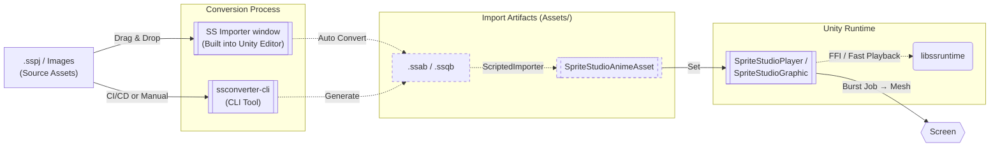

# 🎮 SpriteStudio Player for Unity — Documentation

A high-performance plugin for playing back animations created with [SpriteStudio](https://www.webtech.co.jp/spritestudio/) on [Unity](https://unity.com/).
Playback is performed through `libssruntime`, the shared Rust core provided by [SpriteStudio-SDK](https://github.com/cri-middleware/SpriteStudio-SDK), and combined with Unity's Job System to achieve extreme performance.

!!! tip "No SpriteStudio data of your own yet?"
    The [official sample data](https://www.webtech.co.jp/help/ja/spritestudio7/download/sample/) works as-is — that page is
    Japanese only, but the downloads themselves are language-neutral.
    [Ringo](https://www.webtech.co.jp/help/ja/spritestudio7/download/sample/#ringo) is a good character sample, and
    [Particle](https://www.webtech.co.jp/help/ja/spritestudio7/download/sample/#Perticle_sample) is a good one if you want effects.

## Contents

This documentation is organized by purpose, as follows.

- **For Users** — Install the package and play back animations
    - [Installation](./setup/install.md): Adding the package to your Unity project
    - [Basic Usage](./workflow/usage_basic.md): Placing components and playing back
    - [Asset Import and Editor Integration](./workflow/usage_asset_pipeline.md): Start here for your first `.sspj` import
    - [Generated Assets and AssetBundle](./workflow/generated_assets.md): Per-file roles, dependencies, and how to split bundles
    - [Script Control and Events](./workflow/usage_scripting.md): Control from C# / Timeline and receiving events
    - [Motion Blending](./workflow/motion_blending.md): Layering animations on tracks and cross-fading between them
    - [Performance Tuning and Advanced Settings](./workflow/tips.md): Settings for large-scale rendering and optimization
    - [Migration from SS6Player](./migration_from_ss6.md): Migration guide from the legacy SS6Player for Unity
- **Customization & Automation** — Integrate with CLI and CI/CD
    - [Conversion Features and CI/CD](./workflow/import.md): Batch conversion and automation with `ssconverter-cli`
- **[Limitations & Scope](./limitations.md)** — What is not yet implemented, and the constraints to know before shipping
- **For Player & SDK Developers** — Build the native components from source
    - [Build Guide](./setup/build.md): How to build `libssruntime` / `libssconverter`

## Key Features

This plugin is designed to fully bring out the expressiveness of SpriteStudio on Unity while delivering top-class performance.

*   **Almost Full Feature Support:** Supports the diverse expressions of SpriteStudio out of the box, including bone hierarchies, mesh & deform, particle effects, extended blending, and masks.
*   **Seamless Integration and a Powerful Asset Pipeline:** Simply bring a `.sspj` file into the Unity editor and it is automatically converted in the background into a ScriptableObject ready to use.
*   **Ultra-Fast, Zero-Allocation:** By combining a Rust-based core with Unity's Job System (Burst Compiler), per-frame GC allocations are completely eliminated. This delivers an extremely stable, high frame rate even in mobile environments that render many characters.
*   **Smooth Slow Motion:** Supports sub-frame interpolation, enabling smooth, stutter-free playback even on high-refresh-rate monitors and in slow-motion effects.
*   **Flexible UI and World Rendering:** Supports rendering in ordinary scene space (`SpriteStudioPlayer`) as well as on a uGUI (`SpriteStudioGraphic`) Canvas, and automatically follows Mask and RectMask2D.
*   **Timeline Integration:** Animations can be controlled directly from Timeline tracks, making cutscenes and complex staging easy to implement.
*   **Signals and Events:** Receive "user data" and "signals" set on the timeline as Unity events, allowing you to trigger SE playback and scripts with precise timing.
*   **Motion Blending:** Lay animations over one another on tracks and cross-fade between them, so a character slides from one motion into the next instead of cutting. See [Motion Blending](./workflow/motion_blending.md).
*   **Dynamic Part Following:** Any GameObject can follow (Constraint) a specific part of a character, making it easy to swap weapons or attach effects.
*   **Dynamic Texture Replacement (Avatar Customization / CellMap Overrides):** Swap a cellmap's texture at runtime, per player, to implement color variations or costume / equipment changes for a character.

## Overview

The flow of playing back an animation using this plugin is shown below.

- **Editor (at import time)**: Imports a `.sspj`, automatically converts it to `.ssab` / `.ssqb`, and generates a `SpriteStudioAnimeAsset` that bundles textures, materials, animation names, external references, and more. Pre-generation with `ssconverter-cli` is also possible.
- **Runtime (during playback)**: The player component delegates to the shared core `SpriteStudioPlaybackCore`, `libssruntime` computes the frame data, and a Burst job builds the vertices and uploads them directly to the Mesh.

## Supported Environment

| Item | Details |
|---|---|
| Unity Version | **Unity 6.3 LTS (6000.3)** or later |
| Render Pipeline | Universal (URP) / Built-in (BRP) |
| Dependencies | Burst / Mathematics / Collections / Timeline / uGUI (all standard Unity packages) |
| Supported Platforms | Windows / macOS / Linux / Android / iOS / WebGL (for native libraries, see the [Build Guide](./setup/build.md)) |

> **Note:** The current package version is `7.0.0-beta.1`. The API may change without notice.

## License

This project is released under the BSD-3-Clause license. For details, see the [License](./license.md).

## Third-Party Notices

This project uses third-party open source libraries. For details, see the [Third-Party Notices](./third_party_notices.md).

## Related Repositories

- [SpriteStudio Docs](https://cri-middleware.github.io/SpriteStudio-Docs/) — the documentation portal for the SDK and its official players.
- [SpriteStudio-SDK](https://github.com/cri-middleware/SpriteStudio-SDK) — the SDK itself, providing `libssruntime` / `libssconverter`.
- [SSConverterGUI](https://github.com/cri-middleware/SSConverterGUI) — a standalone desktop GUI for converting `.sspj` without a player.
