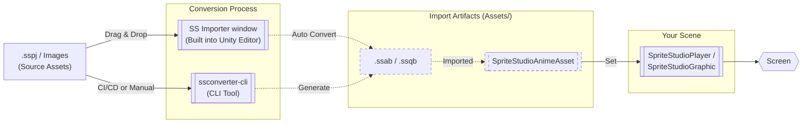

# 🎮 SpriteStudio Player for Unity — Documentation

A plugin for playing back animations created with [SpriteStudio](https://www.webtech.co.jp/spritestudio/) on [Unity](https://unity.com/).
Drop a `.sspj` onto the **SS Importer** window, drag the asset it makes into the Hierarchy, and press Play — no code to reach the first frame.

!!! tip "No SpriteStudio data of your own yet?"
    The [official sample data](https://www.webtech.co.jp/help/ja/spritestudio7/download/sample/) works as-is — that page is
    Japanese only, but the downloads themselves are language-neutral.
    [Ringo](https://www.webtech.co.jp/help/ja/spritestudio7/download/sample/#ringo) is a good character sample, and
    [Particle](https://www.webtech.co.jp/help/ja/spritestudio7/download/sample/#Perticle_sample) is a good one if you want effects.

## Contents

This documentation is organized by purpose, as follows.

- **For Users** — Install the package and play back animations
    - [Installation](./setup/install.md): Adding the package to your Unity project
    - [Basic Usage](./workflow/usage_basic.md): Placing components and playing back
    - [Asset Import and Editor Integration](./workflow/usage_asset_pipeline.md): Start here for your first `.sspj` import
    - [Generated Assets and AssetBundle](./workflow/generated_assets.md): Per-file roles, dependencies, and how to split bundles
    - [Script Control and Events](./workflow/usage_scripting.md): Control from C# / Timeline and receiving events
    - [Motion Blending](./workflow/motion_blending.md): Layering animations on tracks and cross-fading between them
    - [Buttons & UI States](./workflow/ui_buttons.md): uGUI buttons and toggles that show their state, and taking the pointer on the artwork only
    - [Performance Tuning and Advanced Settings](./workflow/tips.md): Settings for large-scale rendering and optimization
    - [Migration from SS6Player](./migration_from_ss6.md): Migration guide from the legacy SS6Player for Unity
- **Customization & Automation** — Integrate with CLI and CI/CD
    - [Conversion Features and CI/CD](./workflow/import.md): Batch conversion and automation with `ssconverter-cli`
- **[Limitations & Scope](./limitations.md)** — What is not yet implemented, and the constraints to know before shipping
- **For Player & SDK Developers** — Build the native components from source, and find your way around the player
    - [Build Guide](./development/build.md): How to build `libssruntime` / `libssconverter`, use a changed package in a project and check it in Unity
    - [How the Player Is Put Together](./development/architecture.md): The layers, and why the player is built the way it is

## Key Features

- **Bring your characters to life.** Breathing and blinking, swaying hair and clothes, flashy slash and magic effects — the motion is built visually in a dedicated editor (SpriteStudio) with bone rigs, mesh deformation and particles. Artists work in their own tool, and Unity just plays the result. Animations crossfade and layer on tracks at runtime, so a walk eases into a run instead of snapping ([Motion Blending](./workflow/motion_blending.md)).
- **Not just characters — effects, UI and whole scenes.** Particle effects sit on the same timeline as the character, so there is no separate effect system to set up. Combine characters, backgrounds, effects and UI into a cutscene or a full-screen sequence, and play it in Unity as a single animation.
- **In your scene or on your UI.** `SpriteStudioPlayer` draws in the world and `SpriteStudioGraphic` on a uGUI Canvas, where it fits its `RectTransform` and follows **Mask** / **RectMask2D**, and can be a button or a toggle that plays a section for each state ([Buttons & UI States](./workflow/ui_buttons.md)). Both are controlled from C# — with per-part overrides, part following, cellmap texture swaps, and callbacks from the artist's user-data, signal and audio keys ([Script Control and Events](./workflow/usage_scripting.md)) — and `SpriteStudioPlayer` can be sequenced on Timeline.
- **A seamless SpriteStudio ⇄ Unity round trip.** Drop a `.sspj` onto the **SS Importer** window and it becomes a ready-to-use asset ([Asset Import and Editor Integration](./workflow/usage_asset_pipeline.md)). To tweak it, click **Open SSPJ** in the Inspector, save in SpriteStudio, then click **Reconvert** — no manual export step. The animation lives in its own asset rather than the scene, so teammates don't collide over scene merges in Git.
- **Zero-parse loading, SIMD and Burst playback.** `.ssab` is a FlatBuffers binary read in place, so loading involves no parsing. Each frame, a SIMD-optimised Rust core and Burst jobs build the meshes zero-copy, with no per-frame GC allocations — light enough for mobile and for scenes with many characters. Turn on **sub-frame interpolation** and motion follows high-refresh-rate displays.

## Overview

The flow of playing back an animation using this plugin is shown below.

- **Editor**: The SS Importer window converts a `.sspj` to `.ssab` / `.ssqb` and generates a `SpriteStudioAnimeAsset` that bundles textures, materials, animation names, external references, and more. `ssconverter-cli` produces the same files in CI.
- **Runtime**: `SpriteStudioPlayer` draws the asset in the scene, and `SpriteStudioGraphic` on a uGUI Canvas.

## License

This project is released under the BSD-3-Clause license. For details, see the [License](./license.md).

## Third-Party Notices

This project uses third-party open source libraries. For details, see the [Third-Party Notices](./third_party_notices.md).

## Related Repositories

- [SpriteStudio Docs](https://cri-middleware.github.io/SpriteStudio-Docs/) — the documentation portal for the SDK and its official players.
- [SpriteStudio-SDK](https://github.com/cri-middleware/SpriteStudio-SDK) — the SDK itself, providing `libssruntime` / `libssconverter`.
- [SSConverterGUI](https://github.com/cri-middleware/SSConverterGUI) — a standalone desktop GUI for converting `.sspj` without a player.
