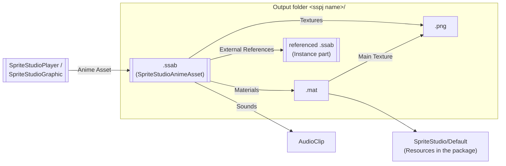

# 📦 Generated Assets and AssetBundle / Addressables

[← Back to documentation index](../index.md)

Converting a `.sspj` produces several files in the output folder. This page covers what you need in order to decide **how much of that belongs in one bundle** for AssetBundle / Addressables: how the files depend on each other, what a reconvert overwrites and what it leaves alone, and what has to be re-shipped after each kind of update.

For the import procedure itself, see [Asset Import and Editor Integration](./usage_asset_pipeline.md).

---

## How the SpriteStudio files map to the output

If you are handed a `.sspj` and asked to take it from there in Unity, the first thing to know is **which SpriteStudio file becomes which converted file**. The roles of `.sspj` / `.ssae` / `.ssce` / `.ssqe` and how they map are the same for every Player, so they are documented in the portal.

> [!NOTE]
> [SpriteStudio Docs: Asset Conversion — How a project's files map to the output](https://cri-middleware.github.io/SpriteStudio-Docs/overview/conversion/#how-a-projects-files-map-to-the-output)
>
> Two points matter here: **one `.ssae` becomes one `.ssab`**, and **cell positions are baked from the `.ssce` into the `.ssab`**. The latter decides whether you can swap the image on its own, below.

### What you did in SpriteStudio, and what that updates

| What you did in SpriteStudio | Output that changes | When shipping |
|---|---|---|
| Repainted the artwork only (cells untouched) | The `.png` alone | Shipping the texture bundle alone is enough |
| Added, moved or resized cells, or changed the image size (the `.ssce` changed) | The `.png` **and** the `.ssab` | **Ship both together.** Shipping one alone makes the artwork shift |
| Edited an animation (`.ssae`) | The corresponding `.ssab` | The bundle containing that `.ssab` |
| Added an anime pack | One more `.ssab` | Register the new asset with a bundle / group |
| Edited a sequence (`.ssqe`) | The `.ssqb` | Nothing in the game changes today |

---

## What gets generated

Converting one `.sspj` creates a `<sspj name>/` folder under the output folder (default: `Assets/ssab_generated`), containing the following files.

| File | Produced from | Unity representation | What it holds |
|---|---|---|---|
| `<anime pack>.ssab` | One file per `.ssae` | `SpriteStudioAnimeAsset` | Animations (keyframes), part structure, **the cell map (the source rectangle, pivot and original image size on the atlas)**, effect definitions, user data / signals, **the referenced texture names (both the cell map atlases and the replacement textures for texture change)**, sound references |
| `<sequence pack>.ssqb` | One file per `.ssqe` | `SpriteStudioSequenceAsset` | The animation playback order (sequence). Playback is not yet supported ([Limitations and Scope](../limitations.md)) |
| `<texture>.png` and so on | The images referenced by the `.sspj` | `Texture2D` | The artwork itself (the atlas image) |
| `<texture>.mat` | Generated automatically on import | `Material` | The shared material used for rendering (shader and texture reference) |
| `*.meta` | Unity | — | GUID, texture import settings, AssetBundle name |

> [!NOTE]
> Exactly one `.mat` is generated per texture, and it is **shared by every `.ssab` that references that texture**.

> [!TIP]
> **The output can live anywhere in the project**
> `Assets/ssab_generated` is only the default. **Output Folder** in the Importer window accepts any folder in the project, and you may move or rename the `<sspj name>/` folder afterwards (the binding to the `.sspj` follows the move). If your Addressables groups are organized by folder, lay the output out to match.
>
> Keep the `.ssab`, its images and its `.mat` **in the same place relative to each other**, though. Textures are looked for inside the `.ssab`'s own folder only — the project is never searched — so splitting the folder's contents apart breaks resolution.

---

## Dependencies

- **Every reference is a hard GUID reference.** Nothing is resolved by file path at runtime, so references resolve wherever the assets live — Resources, AssetBundle or Addressables. Conversely, a bundle that contains a `.ssab` pulls in its dependencies too (`.mat` → `.png`, `AudioClip`, and the `.ssab` an Instance part references).
- **Paths are only searched at import time**: the importer looks for textures in the same folder as the `.ssab`, and uses the `.mat` adjacent to each texture. Move the files in a folder together.
- The **Textures** edge above covers two kinds: the cell map atlases, and the textures a **texture change (TCHG)** swaps in. The importer collects both and references them by GUID, so neither can go missing from a bundle on its own.
- **The shader** lives under `Runtime/Resources` in the package, so it is always included in the player build. The shader used for generated materials can be changed in the import settings shown when a `.ssab` is selected (**Generate Materials** / **Override Shader**).

---

## What a reconvert overwrites, and what it leaves alone

| Target | On reconvert |
|---|---|
| `.ssab` / `.ssqb` / images | **Overwritten.** The files are rewritten rather than deleted, so the `.meta` (GUID, AssetBundle name) survives — and so does Addressables group membership, which is keyed by GUID |
| `.mat` | **Not regenerated** if it already exists. A replaced shader or adjusted properties are kept |
| Texture import settings | The defaults suited to 2D animation (uncompressed, Clamp, mipmaps disabled, and so on) are applied only the first time Unity imports the texture. Settings you change by hand are never overwritten afterwards |
| Images and anime packs removed from the `.sspj` | **Stale files remain** in the output folder. Delete them by hand if they are no longer needed |

---

## How to split across AssetBundles / Addressables

What gets generated are ordinary Unity assets whose references are GUIDs, so **the standard AssetBundle / Addressables flow applies unchanged**. There is no Player-specific procedure.

There is really only one design decision: **at what granularity do you want to be able to replace things?**

| Split | Suits | Watch out for |
|---|---|---|
| **A. One bundle per `<sspj name>/` folder** | Getting started; updating a character as a unit | Even an artwork-only fix ships the whole folder |
| **B. Textures in their own bundle** | Patching appearance alone through a differential update | The atlas layout and image size must stay unchanged (otherwise the `.ssab` has to ship too) |
| **C. Shared assets in a dedicated bundle** | Several `.ssab` files sharing an atlas or the same Instance reference | Updating the shared side affects everyone referencing it |

> [!IMPORTANT]
> A dependency that is not explicitly assigned to a bundle (group) is **duplicated into every bundle that references it**. If several characters share a texture or the target of an Instance part, assign the shared asset explicitly as well. In Addressables, **Tools > Check Duplicate Bundle Dependencies** in the Groups window finds these.

### Patching appearance only (split B)

1. Assign the `.png` to its own group / bundle (the `.ssab` and `.mat` may live in a different bundle).
2. Build and ship the bundles and the application.
3. Repaint the artwork, reload it in SpriteStudio, and save the `.sspj`.
4. Press **Reconvert** on the asset in Unity (re-dropping onto the Importer window does the same). The `.png` is overwritten and its `.meta` is preserved, so the bundle assignment is unchanged.
5. Rebuild the bundles and ship only the texture bundle.

> [!WARNING]
> This works only **while the source rectangles, their sizes, and the overall image size stay the same**. If cells are added or moved in SpriteStudio, or the image size changes, leaving the old `.ssab` in place shifts the artwork, because the source rectangles live in the `.ssab`. Ship the bundle containing the `.ssab` as well in that case.
