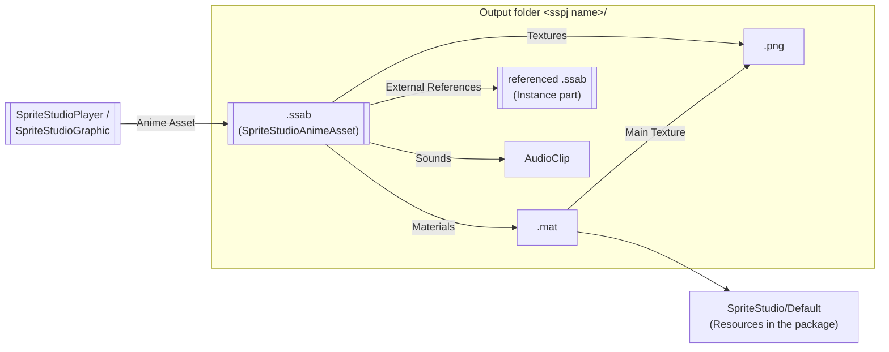

# 📦 Generated Assets and AssetBundle / Addressables

[← Back to documentation index](../index.md)

Converting a `.sspj` produces several files in the output folder. This page covers what you need in order to decide **how much of that belongs in one bundle** for AssetBundle / Addressables: how the files depend on each other, what a reconvert overwrites and what it leaves alone, and what has to be re-shipped after each kind of update.

For the import procedure itself, see [Asset Import and Editor Integration](./usage_asset_pipeline.md).

---

## How the SpriteStudio files map to the output

If you are handed a `.sspj` and asked to take it from there in Unity, the first thing to know is **which SpriteStudio file becomes which converted file**. The roles of `.sspj` / `.ssae` / `.ssce` / `.ssqe` and how they map are the same for every Player, so they are documented in the portal.

> [!NOTE]
> [SpriteStudio Docs: Asset Conversion — How a project's files map to the output](https://cri-middleware.github.io/SpriteStudio-Docs/overview/conversion/#how-a-projects-files-map-to-the-output)
>
> Two points matter here: **one `.ssae` becomes one `.ssab`**, and **cell positions are baked from the `.ssce` into the `.ssab`**. The latter decides whether you can swap the image on its own, below.

### What you did in SpriteStudio, and what that updates

| What you did in SpriteStudio | Output that changes | When shipping |
|---|---|---|
| Repainted the artwork only (cells untouched) | The `.png` alone | Shipping the texture bundle alone is enough |
| Added, moved or resized cells, or changed the image size (the `.ssce` changed) | The `.png` **and** the `.ssab` | **Ship both together.** Shipping one alone makes the artwork shift |
| Edited an animation (`.ssae`) | The corresponding `.ssab` | The bundle containing that `.ssab` |
| Edited an effect (`.ssee`) or sound settings | The `.ssab` that uses it | The bundle containing that `.ssab` |
| Added an anime pack | One more `.ssab` | Register the new asset with a bundle / group |
| Edited a sequence (`.ssqe`) | The `.ssqb` | Nothing in the game changes today |

---

## What gets generated

Converting one `.sspj` creates a `<sspj name>/` folder under the output folder (default: `Assets/ssab_generated`), containing the following files.

| File | Produced from | Unity representation | What it holds |
|---|---|---|---|
| `<anime pack>.ssab` | One file per `.ssae` | `SpriteStudioAnimeAsset` | Animations (keyframes), part structure, **the cell map (the source rectangle, pivot and original image size on the atlas)**, effect definitions, user data / signals, **the referenced texture names (both the cell map atlases and the replacement textures for texture change)**, sound references |
| `<sequence pack>.ssqb` | One file per `.ssqe` | `SpriteStudioSequenceAsset` | The animation playback order (sequence). Playback is not yet supported ([Choosing Between SSAB and SSQB](./tips.md#choosing-between-ssab-and-ssqb)) |
| `<texture>.png` and so on | The images referenced by the `.sspj` | `Texture2D` | The artwork itself (the atlas image) |
| `<sound>.wav` and so on | The sound files referenced by the `.sspj` | `AudioClip` | The audio that Audio keys play |
| `<texture>.mat` | Generated automatically on import | `Material` | The shared material used for rendering (shader and texture reference) |
| `*.meta` | Unity | — | GUID, texture import settings, AssetBundle name |

> [!NOTE]
> Exactly one `.mat` is generated per texture, and it is **shared by every `.ssab` that references that texture**.

> [!TIP]
> **The output can live anywhere under `Assets/`**
>
> `Assets/ssab_generated` is only the default. **Output Folder** in the SS Importer window accepts any folder under `Assets/`, and you may move or rename the `<sspj name>/` folder afterwards (the binding to the `.sspj` follows the move, and **Reconvert** on the asset writes back into the folder it is in). If your Addressables groups are organized by folder, lay the output out to match.
>
> Keep the `.ssab`, its images and its `.mat` **in the same place relative to each other**, though. Textures are looked for inside the `.ssab`'s own folder only — the project is never searched — so splitting the folder's contents apart breaks resolution.

---

## Dependencies



- **Every reference is a hard GUID reference.** Nothing is resolved by file path at runtime, so references resolve wherever the assets live — Resources, AssetBundle or Addressables. Conversely, a bundle that contains a `.ssab` pulls in its dependencies too (`.mat` → `.png`, `AudioClip`, and the `.ssab` an Instance part references).
- **Paths are only searched at import time**: the importer looks for textures and sound files in the same folder as the `.ssab`, and uses the `.mat` adjacent to each texture. The `.ssab` an Instance part plays is looked for in that folder first, then by file name in the whole project. Move the files in a folder together.
- The **Textures** edge above covers two kinds: the cell map atlases, and the textures a **texture change (TCHG)** swaps in. The importer collects both and references them by GUID, so neither can go missing from a bundle on its own.
- **The shader** lives under `Runtime/Resources` in the package, so it is always included in the player build. The shader a `.mat` is created with can be chosen in the import settings shown when a `.ssab` is selected (**Generate Materials** / **Override Shader**). It applies when a `.mat` is created; a `.mat` that already exists keeps its own shader, so change that on the `.mat` itself.
- A texture with no `.mat` is drawn with a material the Player makes at runtime, the same as the `.mat` would be. That covers **Generate Materials** turned off, and the moment between a `.ssab`'s import and its `.mat` being written.

### Bundles without a `.mat`

A `.mat` references the shader, so a bundle containing a `.mat` also carries **its own copy of the shader**, next to the one in the player build. Turning **Generate Materials** off in the `.ssab`'s import settings avoids that:

- No `.mat` is written or used. The asset references only its textures, and the Player makes each texture's material at runtime from the shader in the player build. The bundle carries no shader.
- An existing `.mat` is left in place, but the asset stops referencing it, so it no longer goes into a bundle.
- Every `.ssab` drawing a texture shares one runtime material for it, as they share one `.mat`.
- A shader set in **Override Shader** is referenced by the asset and goes into the bundle with it.

> [!IMPORTANT]
> A runtime material keeps its texture until every asset using the texture is destroyed. **Destroy or release the `.ssab` assets before unloading the bundle holding their textures**: unloading the textures first leaves those assets drawing without them, and the textures' memory stays in use.

### Loading a `.ssab` that was not imported

A `.ssab` can also be shipped as plain bytes, for example renamed to `.bytes` and loaded as a `TextAsset`, or downloaded, and built into an asset at runtime with `SpriteStudioAnimeAssetLoader`. The textures and sounds stay ordinary imported assets that you load yourself. Nothing is looked up by path at runtime, so you hand them over.

```csharp
using SpriteStudio.Runtime;

byte[] bytes = ssabBytes.bytes;

// 1. What the .ssab needs: textures, sounds, and the other anime packs its Instance parts play.
foreach (var dep in SpriteStudioAnimeAssetLoader.GetDependencies(bytes))
    Debug.Log(dep); // e.g. "Texture: Ringo.png"

// 2. Load those however you like (AssetBundle, Addressables...), then build the asset.
Texture2D[] textures = bundle.LoadAllAssets<Texture2D>();
SpriteStudioAnimeAsset asset = SpriteStudioAnimeAssetLoader.Create(bytes, textures);
player.AnimeAsset = asset;

// 3. When done: destroy the asset, then unload the textures.
Destroy(asset);
```

- **Matching names.** The `.ssab` names each file by its path relative to the `.sspj`. The overload above matches by file name, without the extension and ignoring case: `images/Ringo.png` matches a `Texture2D` named `Ringo`. When file names cannot tell two of the `.ssab`'s names apart (`a/body.png` and `b/body.png`), or two textures given share a name, it throws `ArgumentException`. Pass a function from name to `Texture2D` instead in that case. It is called once per name.
- **Give the same `Texture2D` for the same image.** The runtime materials are shared per `Texture2D` object. Loading one image twice makes two textures, and they no longer share.
- **Texture import settings.** The settings suited to 2D animation are applied only to an image Unity first imports into a folder that holds a `.ssab` or `.sspj` (see [Conversion Features and CI/CD](./import.md)). Import the images in the converter's output folder, next to their `.ssab`, and bundle them from there. An image imported anywhere else keeps Unity's defaults, so set it in the Inspector: Compression **None**, mipmap generation off, Wrap Mode **Clamp**, Filter Mode **Bilinear**, **Alpha Is Transparency** on, Max Size **8192**, Non-Power of 2 **None**. A texture the application makes at runtime, for example with `Texture2D.LoadImage`, has no import settings: make it without mipmaps and set its `wrapMode` to `TextureWrapMode.Clamp`.
- **Missing files.** A texture you do not provide is reported, and its parts do not draw correctly, as when the import cannot find a texture. A sound you do not provide is reported and stays silent. Passing no sounds at all builds an asset with none.
- **Instance parts that play another pack.** Build every pack the asset needs, then pass them all to `SpriteStudioAnimeAssetLoader.LinkExternalReferences`. It points each Instance at its pack, as the import does, and reports the packs that are missing. Link the assets before they play.
- **You own what you create.** The assets are plain `ScriptableObject`s and are not destroyed with the scene. `Destroy` each one when done. That hands back its share of the runtime materials. Destroy the assets before unloading their textures, as for imported assets above.
- **Override Shader.** Pass a shader as the last argument to draw with it instead of `SpriteStudio/Default`.

---

## What a reconvert overwrites, and what it leaves alone

| Target | On reconvert |
|---|---|
| `.ssab` / `.ssqb` / images | **Overwritten.** The files are rewritten rather than deleted, so the `.meta` (GUID, AssetBundle name) survives — and so does Addressables group membership, which is keyed by GUID |
| `.mat` | **Not regenerated** if it already exists. A replaced shader or adjusted properties are kept |
| Texture import settings | The defaults suited to 2D animation (uncompressed, Clamp, mipmaps disabled, and so on) are applied only the first time Unity imports the texture. Settings you change by hand are never overwritten afterwards |
| Two `.sspj` in **one** import whose file names match | Their output folder is the same, so only the first is converted. The rest are named in the console — rename one, or import them into separate output folders |
| Images and anime packs removed from the `.sspj` | **Stale files remain** in the output folder. Delete them by hand if they are no longer needed |

---

## How to split across AssetBundles / Addressables

What gets generated are ordinary Unity assets whose references are GUIDs, so **the standard AssetBundle / Addressables flow applies unchanged**. There is no Player-specific procedure.

There is really only one design decision: **at what granularity do you want to be able to replace things?**

| Split | Suits | Watch out for |
|---|---|---|
| **A. One bundle per `<sspj name>/` folder** | Getting started; updating a character as a unit | Even an artwork-only fix ships the whole folder |
| **B. Textures in their own bundle** | Patching appearance alone through a differential update | The atlas layout and image size must stay unchanged (otherwise the `.ssab` has to ship too) |
| **C. Shared assets in a dedicated bundle** | Several `.ssab` files sharing an atlas or the same Instance reference | Updating the shared side affects everyone referencing it |

> [!IMPORTANT]
> A dependency that is not explicitly assigned to a bundle (group) is **duplicated into every bundle that references it**. If several characters share a texture or the target of an Instance part, assign the shared asset explicitly as well. In Addressables, open the Analyze window (**Tools > Window > Analyze** in the Groups window, or **Window > Asset Management > Addressables > Analyze**) and run the **Check Duplicate Bundle Dependencies** rule to find these.

### Patching appearance only (split B)

1. Assign the `.png` to its own group / bundle (the `.ssab` and `.mat` may live in a different bundle).
2. Build and ship the bundles and the application.
3. Repaint the artwork, reload it in SpriteStudio, and save the `.sspj`.
4. Press **Reconvert** on the asset in Unity. The `.png` is overwritten and its `.meta` is preserved, so the bundle assignment is unchanged. (Dropping the `.sspj` onto the SS Importer window converts it too, but into `<Output Folder>/<sspj name>/` — a different place once the folder has been moved or renamed.)
5. Rebuild the bundles and ship only the texture bundle.

> [!WARNING]
> This works only **while the source rectangles, their sizes, and the overall image size stay the same**. If cells are added or moved in SpriteStudio, or the image size changes, leaving the old `.ssab` in place shifts the artwork, because the source rectangles live in the `.ssab`. Ship the bundle containing the `.ssab` as well in that case.
