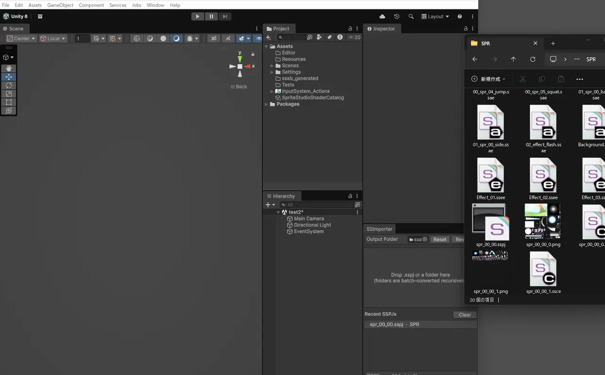
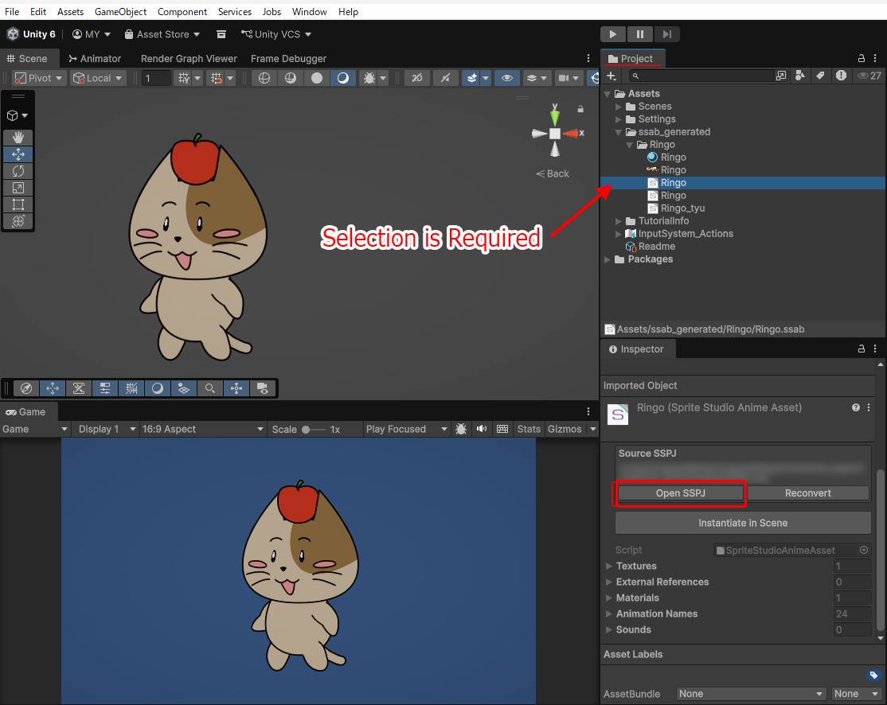
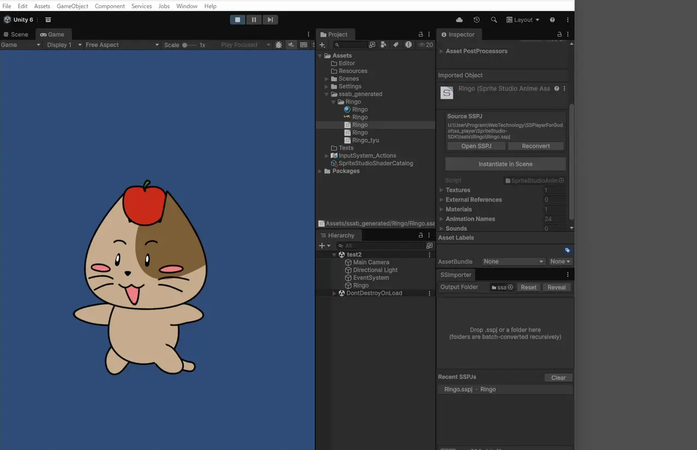

# 🗂️ Asset Import and Editor Integration

[← Back to documentation index](../index.md)

This page explains the **initial procedure for importing (converting) a `.sspj` into a Unity project**, and the workflow for iterating quickly by moving back and forth between SpriteStudio and Unity.

Besides playing animations, SpriteStudio Player for Unity lets you move between SpriteStudio and Unity as you iterate, from editing an animation to seeing it in your game.

---

## 1. First Import (Converting .sspj to .ssab)

The SpriteStudio source data, the project file (`.sspj`), cannot be played back in Unity as-is.
You need to convert it into a dedicated optimized binary (**`.ssab`**) that can be played back and controlled in Unity before importing it.

If no `.ssab` yet exists in the Unity project, perform the initial conversion with the following steps.

1. From the Unity menu, open **Window > SpriteStudio > Importer**.
2. Check the output destination (**Output Folder**, default `Assets/ssab_generated`).
3. From Explorer or Finder, **drag and drop the target `.sspj` file onto the SS Importer window** — the box in the middle lights up while you drag.

That alone runs the conversion, generating a `SpriteStudioAnimeAsset` (a ScriptableObject containing the `.ssab`) at the specified output destination.
The result is `Assets/ssab_generated/<sspj name>/`; the file to drag is the `.ssab` (the one with the SpriteStudio icon, for example `Ringo.ssab`).
Drag and drop the generated asset onto the Hierarchy window or Scene view to place a `SpriteStudioPlayer` / `SpriteStudioGraphic` (see [Basic Usage](./usage_basic.md) for details).

> [!TIP]
> 
> <video autoplay loop muted playsinline width="100%">
>   <source src="../assets/1-sspj_import.webm" type="video/webm">
> </video>
> 

> [!TIP]
> If you drop a whole folder, the `.sspj` files inside it are recursively batch-converted to `.ssab`. See [Conversion Features and CI/CD](./import.md) for details.

---

## 2. Opening SpriteStudio Directly from Unity

If, while working in Unity, you think "I'd like to fine-tune the animation a bit more," there is no need to launch SpriteStudio separately and hunt for the project.

1. In the Project window, **select the `SpriteStudioAnimeAsset`** you want to edit.
2. In the Inspector, under **Imported Object**, **"Source SSPJ"** shows the path to the original `.sspj`.
3. Click the **"Open SSPJ" button** below it.

This launches SpriteStudio, opens the original `.sspj` file, and lets you start editing right away.

A `SpriteStudioPlayer` or `SpriteStudioGraphic` in the scene has the same **Open SSPJ** button under its **Anime Asset** field, so you can keep the character selected in the Hierarchy instead of finding its asset in the Project window.

> [!NOTE]
> 

> [!NOTE]
> The equivalent operation is also available from the **Recent SSPJs** list in **Window > SpriteStudio > Importer** (right-click a row → "Open SSPJ").

---

## 3. Reconverting After Saving in SpriteStudio

Once you have edited and saved the animation on the SpriteStudio side, return to the Unity Editor.
With just the following operation, your changes are reflected instantly in the game (and in the preview in the Editor).

1. As before, select the target **`SpriteStudioAnimeAsset`** in the Project window, or the `SpriteStudioPlayer` / `SpriteStudioGraphic` in the scene.
2. Click the **"Reconvert" button** next to the "Open SSPJ" button in the Inspector.

> [!IMPORTANT]
> **The shortest "Open" → "Save" → "Reconvert" workflow**
>
> With the character still selected in the scene, you can invoke SpriteStudio from the Inspector, reconvert as soon as you have saved, and play the result with **Play in Edit Mode** in the same Inspector (see [Preview in edit mode](./usage_basic.md#preview-in-edit-mode)).

> [!TIP]
> You can also reconvert from **Recent SSPJs** in the SS Importer window (click a row, or right-click → "Reconvert").

> [!TIP]
> 
> <video autoplay loop muted playsinline width="100%">
>   <source src="../assets/2-fast_iteration_inspector.webm" type="video/webm">
> </video>
> 

---

## The Generated `SpriteStudioAnimeAsset` (.ssab)

This is the final product of the import: it holds the converted `.ssab` data and everything needed to play it, and keeps its textures in the build. Its Inspector shows these fields, in this order:

| Field | Description |
|---|---|
| **Textures** | Referenced textures |
| **External References** | External animations referenced by Instance parts (a `SpriteStudioAnimeAsset` from another pack) |
| **Materials** | The base materials used for rendering |
| **Animation Names** | The list of animation names contained in this asset |
| **Sounds** | The `AudioClip`s referenced by Audio events |

> [!NOTE]
> When an animation references another animation (an Instance part), that reference is resolved into **External References**. At runtime it simply follows the hard reference without loading a file, so it works safely with Resources, AssetBundle, or Addressables.

When a `.ssab` is imported, a **shared material (`.mat`)** corresponding to the referenced texture is automatically generated in an adjacent location and bundled into the asset. In addition, textures in the same folder as the `.ssab` automatically have import settings suited to 2D animation applied (uncompressed, Clamp, Mipmap disabled, and so on).

> [!TIP]
> [Generated Assets and AssetBundle](./generated_assets.md) covers what each generated file is responsible for, how they depend on each other, what changes in the game when you update one, and how to split them across AssetBundles / Addressables.

---

## Limitations and Notes for Team Development

`Open SSPJ` and `Reconvert` have some limitations. Keep them in mind, especially when working in a team.

> [!WARNING]
> **SpriteStudio must be installed**
>
> Pressing the `Open SSPJ` button launches SpriteStudio via the OS file association. Therefore, [SpriteStudio](https://www.webtech.co.jp/spritestudio/) must be installed on the PC you are operating.

> [!TIP]
> **File path sharing and smart relinking in team development**
>
> The integration information from importing via the SS Importer window (the `.ssab` ↔ `.sspj` binding) is saved as a **relative path** in `ProjectSettings/SpriteStudioSourceMap.json` directly under the Unity project.
>
> By sharing this file through a version control system such as Git, the path integration is maintained when another team member does `git clone` and has the `.sspj` at the same relative location from the Unity project, and they can use `Open SSPJ` and `Reconvert` as-is.
>
> Even if the link to a `.sspj` breaks—for example, due to a change in folder structure—it is easy to repair. Pressing the **"Relink SSPJ..."** button, which the Inspector shows in place of **Open SSPJ** and **Reconvert**, opens a dialog asking for the new location of the `.sspj`. Simply relinking a single file here also **smart-relinks and reconverts, all at once,** the other related `.ssab` files in the same output folder, so repair takes little effort.
