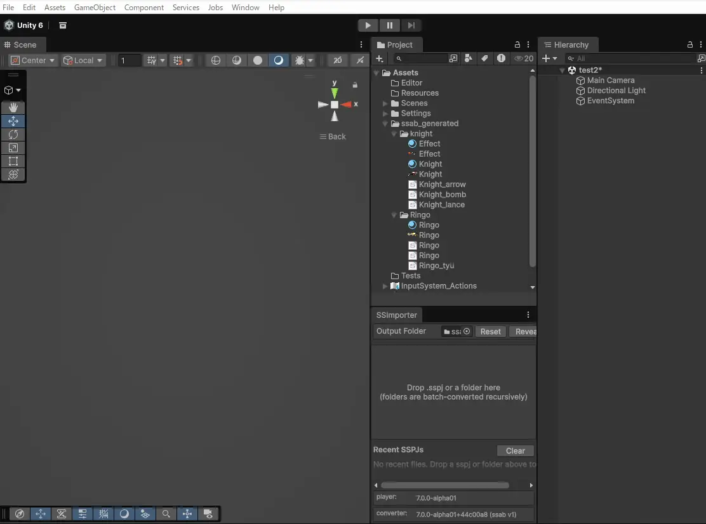
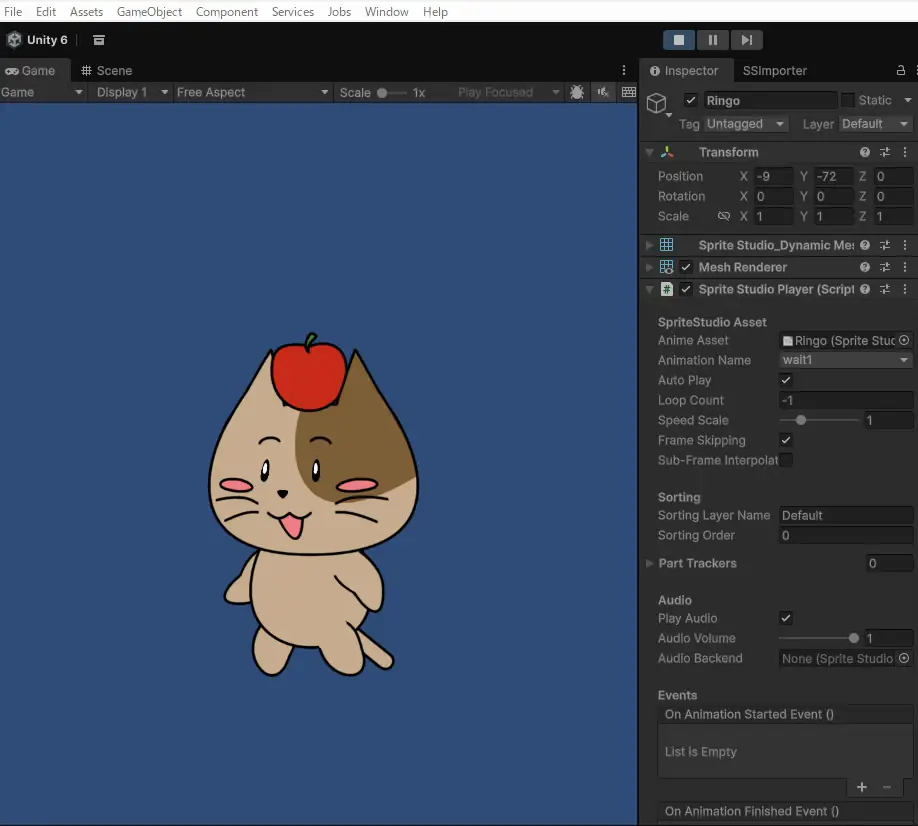

# ▶️ Basic Usage

[← Back to documentation index](../index.md)

This page describes the shortest path from importing a `.sspj` to playing back an animation. For import details, see [Asset Import and Editor Integration](./usage_asset_pipeline.md); for control via scripting, see [Scripting Control and Events](./usage_scripting.md).

## 1. Import an animation

1. From the Unity menu, open **Window > SpriteStudio > Importer**.
2. Set the **Output Folder** (the default is `Assets/ssab_generated`).
3. Drag and drop the `.sspj` file you created in SpriteStudio onto the window's drop area.

When conversion completes, a `SpriteStudioAnimeAsset` (a ScriptableObject that embeds the `.ssab`) is generated in the output folder.

> [!TIP]
> If you do not have a `.sspj` yet and just want to try this out, the [official SpriteStudio sample data](https://www.webtech.co.jp/help/ja/spritestudio7/download/sample/) works as-is (that page is only available in Japanese; the downloads themselves are language-neutral). [Ringo](https://www.webtech.co.jp/help/ja/spritestudio7/download/sample/#ringo) is a good character sample, and [Particle](https://www.webtech.co.jp/help/ja/spritestudio7/download/sample/#Perticle_sample) is a good one if you want effects. Drop the downloaded `.sspj` in exactly as described above.

## 2. Place a player

Use one of two components depending on your use case.

| Use case | Component | Rendering method |
|---|---|---|
| 3D / 2D world space | `SpriteStudioPlayer` | MeshRenderer |
| Canvas (uGUI) UI | `SpriteStudioGraphic` | CanvasRenderer |

### Method A: Drag and drop the asset to place it (recommended)

This is the easiest method. From the Project window, drag and drop the `SpriteStudioAnimeAsset` generated during import (the asset marked with the SpriteStudio icon) onto the **Hierarchy window** (or the **Scene view**).

When you drop it, a menu appears for choosing which component to place, so select the one that fits your use case.

- **SpriteStudioPlayer** … For world space. A GameObject with the selected asset assigned is created.
- **SpriteStudioGraphic (Canvas UI)** … For Canvas UI.

Once selected, a GameObject is created, and **the asset you just dropped is automatically assigned to Anime Asset**, with **Animation Name** set to its first animation. Pick another from the **Animation Name** list if you want a different one.

> [!TIP]
> - If you choose **SpriteStudioGraphic (Canvas UI)** and there is no `Canvas` in the scene, a `Canvas` (and an `EventSystem`, with the input module your project's input handling uses) is automatically created as **GameObject > UI > Canvas** creates them, and the player is placed underneath it.
> - If you drop it onto an existing GameObject in the Hierarchy, it is placed as a child of that GameObject; dropped between two rows, it is placed beside them.
> - In Prefab Mode it is placed inside the prefab you are editing, as the GameObject menu places objects.
> - If you drop multiple assets at once, they are all placed together.
> - You can also place a world player from the **"Instantiate in Scene"** button in the `SpriteStudioAnimeAsset` Inspector.

> [!TIP]
> 
> <video autoplay loop muted playsinline width="100%">
>   <source src="../assets/3-setup_drag_and_drop.webm" type="video/webm">
> </video>
> 

### Method B: Add the component manually

This method uses an empty GameObject to which you add the component yourself.

#### Placing in world space (`SpriteStudioPlayer`)

1. Create an empty GameObject.
2. From **Add Component**, add **SpriteStudio Player** (`MeshFilter` / `MeshRenderer` are added automatically).
3. In the Inspector, assign the imported `SpriteStudioAnimeAsset` to **Anime Asset**, under the **SpriteStudio Asset** heading.
4. Pick the animation to play from **Animation Name**. Once the asset is assigned it is a list, starting on the asset's first animation.

#### Placing on a Canvas (uGUI) (`SpriteStudioGraphic`)

1. Create an empty GameObject under a **Canvas**.
2. From **Add Component**, add **SpriteStudio Graphic** (`RectTransform` / `CanvasRenderer` are added automatically).
3. Set **Anime Asset** and **Animation Name** the same way as above.

## 3. Play back

If **Auto Play** is enabled (the default), the animation in **Animation Name** plays back automatically when you enter Play mode, and again each time the object is enabled again: a pooled object taken back out with `SetActive(true)` starts over, as an Animator does.

To play back explicitly from a script, do the following.

```csharp
using SpriteStudio.Runtime;
using UnityEngine;

public class Sample : MonoBehaviour
{
    [SerializeField] private SpriteStudioPlayer _player;

    void Start()
    {
        _player.SetAnimation("walk"); // Specify the animation (load the data)
        _player.Play();               // Start playback
    }
}
```

## Main Inspector settings

Item names are written exactly as they appear in the Inspector, in the order the Inspector shows them.

### Common to both components

| Item | Default | Description |
|---|---|---|
| **Anime Asset** | (none) | The `SpriteStudioAnimeAsset` to play back. It sits under a heading labelled **SpriteStudio Asset** |
| **Animation Name** | `""` | The name of the animation to play. Once an asset is assigned, this becomes a dropdown, and assigning one sets it to the asset's first animation if the asset lacks the current name. A name the asset does not have shows as `(missing)` rather than being replaced |
| **Auto Play** | `true` | Whether to play back automatically when the scene starts running, and again whenever the component is enabled again |
| **Loop Count** | `-1` | Number of loops (`-1` = infinite / `1` = once / `n` = n times / `0` = infinite, a synonym for `-1`) |
| **Speed Scale** | `1.0` | Playback speed multiplier (a `0`–`4` slider; `0` is a stop) |
| **Frame Skipping** | `true` | Real-time tracking. ON = advance by the elapsed time / OFF = advance one frame per update |
| **Sub-Frame Interpolation** | `false` | Whether to perform inter-frame interpolation (sub-frame rendering) |

The audio items are common too.

| Item | Default | Description |
|---|---|---|
| **Play Audio** | `true` | Whether to play sounds from audio events (ADIO). Turned off, the events still fire, for playing the sounds yourself (see [Scripting Control and Events](./usage_scripting.md)); the item below is greyed out |
| **Audio Volume** | `1.0` | Volume of the built-in playback |

At the end of the Inspector sit the playback-event UnityEvents (**On Animation Started Event** / **On Animation Finished Event** / **On Animation Looped Event** / **On User Data Event** / **On Signal Event** / **On Audio Event**). See [Scripting Control and Events](./usage_scripting.md) for details.

### `SpriteStudioPlayer` (world) only

The draw order is the Mesh Renderer's own **Sorting Layer** / **Order in Layer** (under **Additional Settings** in its Inspector), as it is for any renderer; the `SortingLayerName` / `SortingOrder` script properties read and write the same two values.

| Item | Default | Description |
|---|---|---|
| **Flip X / Flip Y** | `false` / `false` | Mirror only what is drawn, horizontally / vertically (the same idea as `SpriteRenderer.flipX`: the Transform is not negated, so children and colliders stay put) |
| **Offset** | `(0, 0)` | Shift the drawn animation without moving the Transform (in world units) |
| **Shader Catalog** | (none) | Your own catalog of per-part custom shaders, looked up before the built-in AddOns (see [Advanced Settings](./tips.md)) |
| **Part Trackers** | (empty) | Settings that make a Transform follow a specified part (see [Scripting Control and Events](./usage_scripting.md)) |
| **Cellmap Texture Overrides** | (empty) | Texture replacements by cellmap name, saved with the scene (see [Scripting Control and Events](./usage_scripting.md)) |

> **Pixels Per Unit** is configured outside this Inspector, from the `PixelsPerUnit` script property. Per-part **custom shaders** go in a catalog you assign to **Shader Catalog**. See [Advanced Settings](./tips.md).

### `SpriteStudioGraphic` (Canvas UI) only

The **Color** / **Material** / **Raycast Target** / **Raycast Padding** / **Maskable** items inherited from uGUI's `Graphic` are shown. **Color** tints the whole animation, as it tints an `Image`, on top of the part colours; a Button's **Color Tint** transition and `CrossFadeColor` / `CrossFadeAlpha` reach it the same way. **Material** left empty draws with the atlas material; a material assigned there is used instead when its shader is built from `SpriteStudio/Canvas`, the only kind that reads the vertex layout the graphic emits. A **Mask** added to the graphic itself clips its children to the animation's shape. The clickable area is the `RectTransform`'s rectangle, which is not tied to how large the animation looks. To widen it, adjust the `RectTransform`'s size or use **Raycast Padding**. After these comes **Cellmap Texture Overrides**, as on `SpriteStudioPlayer`.

> [!TIP]
> 
> <video autoplay loop muted playsinline width="100%">
>   <source src="../assets/4-inspector_preview.webm" type="video/webm">
> </video>
> 

## Preview in edit mode

Both components also run in edit mode. Place one in a scene and a **static preview of the start frame** appears in the Scene / Game view without entering Play mode. It is always on.

What edit mode shows is a still image, though — playback does not advance. To check the animation's motion, enter **Play mode**.

## Support for mask parts

This plugin also supports SpriteStudio's "Mask" feature.

- **World (`SpriteStudioPlayer`)**: No special configuration is required. If the `.ssab` contains mask parts, clipping is performed automatically using the stencil buffer. You can use it as-is by placing it in the scene.
- **Canvas (`SpriteStudioGraphic`)**: SpriteStudio's internal masks are suppressed, and instead it follows uGUI's **Mask** / **RectMask2D** (placing these on a parent clips the content).

For details, see [Performance Tuning and Advanced Settings](./tips.md#masking-and-clipping).

> [!TIP]
> 
> <video autoplay loop muted playsinline width="100%">
>   <source src="../assets/6-mask.webm" type="video/webm">
> </video>
> 
