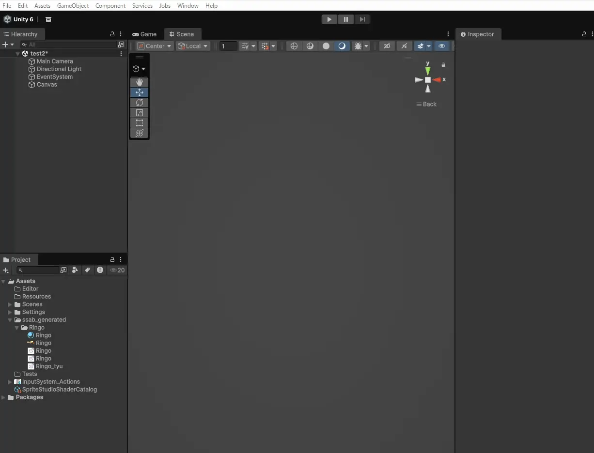

# ▶️ Basic Usage

[← Back to documentation index](../index.md)

This page describes the shortest path from importing a `.sspj` to playing back an animation. For import details, see [Asset Import and Editor Integration](./usage_asset_pipeline.md); for control via scripting, see [Scripting Control and Events](./usage_scripting.md).

## 1. Import an animation

1. From the Unity menu, open **Window > SpriteStudio > Importer**.
2. Set the **Output Folder** (the default is `Assets/ssab_generated`).
3. Drag and drop the `.sspj` file you created in SpriteStudio onto the window's drop area.

When conversion completes, a `SpriteStudioAnimeAsset` (a ScriptableObject that embeds the `.ssab`) is generated in the output folder.

## 2. Place a player

Use one of two components depending on your use case.

| Use case | Component | Rendering method |
|---|---|---|
| 3D / 2D world space | `SpriteStudioPlayer` | MeshRenderer |
| Canvas (uGUI) UI | `SpriteStudioGraphic` | CanvasRenderer |

### Method A: Drag and drop the asset to place it (recommended)

This is the easiest method. From the Project window, drag and drop the `SpriteStudioAnimeAsset` generated during import (the asset marked with the SpriteStudio icon) onto the **Hierarchy window** (or the **Scene view**).

When you drop it, a menu appears for choosing which component to place, so select the one that fits your use case.

- **SpriteStudioPlayer** … For world space. A GameObject with the selected asset assigned is created.
- **SpriteStudioGraphic (Canvas UI)** … For Canvas UI.

Once selected, a GameObject is created, and **the asset you just dropped is automatically assigned to SpriteStudio Asset**. After that, set the **Animation Name** to play it back.

> [!TIP]
> - If you choose **SpriteStudioGraphic (Canvas UI)** and there is no `Canvas` in the scene, a `Canvas` (and an `EventSystem`) is automatically created, and the player is placed underneath it.
> - If you drop it onto an existing GameObject in the Hierarchy, it is placed as a child of that GameObject.
> - If you drop multiple assets at once, they are all placed together.
> - You can also place a world player from the **"Instantiate in Scene"** button in the `SpriteStudioAnimeAsset` Inspector.

> [!TIP]
> 
> <video autoplay loop muted playsinline width="100%">
>   <source src="../assets/3-setup_drag_and_drop.webm" type="video/webm">
> </video>
> 

### Method B: Add the component manually

This method uses an empty GameObject to which you add the component yourself.

#### Placing in world space (`SpriteStudioPlayer`)

1. Create an empty GameObject.
2. From **Add Component**, add **SpriteStudio Player** (`MeshFilter` / `MeshRenderer` are added automatically).
3. In the Inspector, assign the imported `SpriteStudioAnimeAsset` to **SpriteStudio Asset**.
4. Enter the name of the animation you want to play in **Animation Name**.

#### Placing on a Canvas (uGUI) (`SpriteStudioGraphic`)

1. Create an empty GameObject under a **Canvas**.
2. From **Add Component**, add **SpriteStudio Graphic** (`RectTransform` / `CanvasRenderer` are added automatically).
3. Set **SpriteStudio Asset** and **Animation Name** the same way as above.

## 3. Play back

If **Auto Play** is enabled (the default), the animation in **Animation Name** plays back automatically when you enter Play mode.

To play back explicitly from a script, do the following.

```csharp
using SpriteStudio.Runtime;
using UnityEngine;

public class Sample : MonoBehaviour
{
    [SerializeField] private SpriteStudioPlayer _player;

    void Start()
    {
        _player.SetAnimation("walk"); // Specify the animation (load the data)
        _player.Play();               // Start playback
    }
}
```

## Main Inspector settings

These are the settings common to both `SpriteStudioPlayer` and `SpriteStudioGraphic`.

| Item | Default | Description |
|---|---|---|
| **SpriteStudio Asset** | (none) | The `SpriteStudioAnimeAsset` to play back |
| **Animation Name** | `""` | The name of the animation to play |
| **Auto Play** | `true` | Whether to play back automatically when the scene starts running |
| **Loop Count** | `-1` | Number of loops (`-1` = infinite / `1` = once / `n` = n times / `0` = infinite, a synonym for `-1`) |
| **Speed Scale** | `1.0` | Playback speed multiplier |
| **Sub Frame Enabled** | `false` | Whether to perform inter-frame interpolation (sub-frame rendering) |
| **Skip Frames** | `true` | Real-time tracking. ON = advance by the elapsed time / OFF = advance one frame per update |

`SpriteStudioPlayer` (world) has the following additional items.

| Item | Default | Description |
|---|---|---|
| **Sorting Layer / Sorting Order** | `Default` / `0` | Draw order (MeshRenderer sort settings) |
| **Pixels Per Unit (PPU)** | `1` | The number of pixels per world unit. To match Unity's sprite convention, set a value such as `100` |
| **Shader Catalog** | (none) | A catalog of per-part AddOn / custom shaders (see [Advanced Settings](./tips.md)) |
| **Part Trackers** | (empty) | Settings that make a Transform follow a specified part (see [Scripting Control and Events](./usage_scripting.md)) |

> [!TIP]
> 
> <video autoplay loop muted playsinline width="100%">
>   <source src="../assets/4-inspector_preview.webm" type="video/webm">
> </video>
> 

## Preview in edit mode

Both components run with `[ExecuteAlways]`, so when you place them in a scene, a **static preview of the start frame** is displayed. However, playback does not advance in edit mode. To check the animation's motion, enter **Play mode**.

## Support for mask parts

This plugin also supports SpriteStudio's "Mask" feature.

- **World (`SpriteStudioPlayer`)**: No special configuration is required. If the `.ssab` contains mask parts, clipping is performed automatically using the stencil buffer. You can use it as-is by placing it in the scene.
- **Canvas (`SpriteStudioGraphic`)**: SpriteStudio's internal masks are suppressed, and instead it follows uGUI's **Mask** / **RectMask2D** (placing these on a parent clips the content).

For details, see [Performance Tuning and Advanced Settings](./tips.md#masking-and-clipping).

> [!TIP]
> 
> <video autoplay loop muted playsinline width="100%">
>   <source src="../assets/6-mask.webm" type="video/webm">
> </video>
> 
