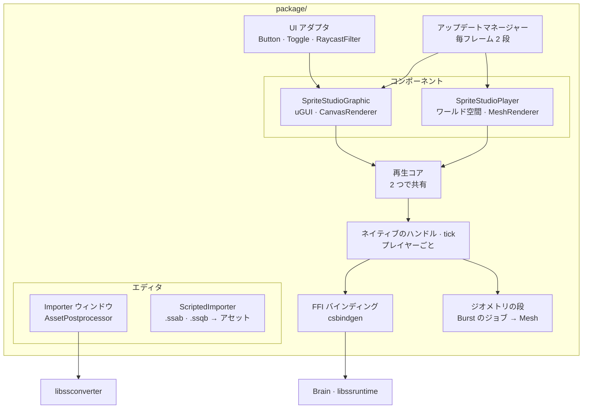

# 🧩 プレイヤーの構成

[← ドキュメント目次へ戻る](../index.md)

SpriteStudio Player for Unity を開発する人と、自分のプロジェクトのために改造する人に向けたページです。部品をその役割で説明します。ネイティブライブラリのビルド、変更したパッケージをプロジェクトで使う方法、Unity での確かめ方は[ビルドガイド](build.md)に、制約・セットアップ・テストは [CONTRIBUTING](https://github.com/cri-middleware/SSPlayerForUnity/blob/HEAD/CONTRIBUTING.md) にあります。

SpriteStudio の Player に共通すること（再生・モーションブレンド・サウンドキー・パーツトラッキングの振る舞い）は、SDK の [Player Porting Guide](https://github.com/cri-middleware/SpriteStudio-SDK/blob/HEAD/libs/ssruntime/docs/README.md) に一度だけ書いてあります。

## 層

パッケージは `package/` です。薄い C# の層が、csbindgen が生成する FFI バインディングで Rust のランタイム `libssruntime` を動かし、各フレームのジオメトリを Burst のジョブで組み立てて `Mesh` にアップロードします。エディタは `libssconverter` で `.sspj` を変換します。矢印は呼び出しです。

**再生**（`package/Runtime/`）:

- ジオメトリの段は 1 フレームの描画データをバッチ・サブメッシュ・マスクの手順・エフェクトの四角形に変え、Burst のジョブで頂点を書いてアップロードします。インデックスはトポロジーが変わったときだけ送り直します。
- マテリアルはテクスチャとブレンドごとに持ち、パーツ単位のシェーダーは `SpriteStudioShaderCatalog` が対応付けます。組み込みのサウンド、イベント、パーツへの追従（`SpriteStudioPartTracker`）、パーツ単位とテクスチャの上書き、Timeline のトラックがその横にあります。
- インポートしたアセットは `SpriteStudioAnimeAsset` と `SpriteStudioSequenceAsset` です。
- FFI バインディングとネイティブライブラリは生成またはダウンロードするもので、git には無く、`.meta` だけがあります。`.ssab` の読み取り（flatc の出力）と FlatBuffers の C# ランタイムはコミット済みです。

**UI アダプタ**（`package/Runtime/UI/`、アセンブリ `SpriteStudio.UI`）: UI の状態ごとにグラフィックのアニメーションの区間を流す `SpriteStudioButton` と `SpriteStudioToggle`、パーツの輪郭で uGUI の raycast に答える `SpriteStudioRaycastFilter` です。状態の規則は純粋な関数で、ドライバがそれをグラフィックに当てます。コアからは呼びません。アダプタは、読み込み直しやほかのスクリプトによる再生の変更に気づくため、ランタイムがセットアップしたアニメーションと区間を `InternalsVisibleTo` で読みます。インスペクタは `package/Editor/UI/` にあります。

**エディタ**（`package/Editor/`）: ドロップされたものの下の `.sspj` を集めて変換をキューに入れる Importer ウィンドウ（**Window > SpriteStudio > Importer**）、`Assets/` に入った `.sspj` を変換し、テクスチャごとの共有マテリアルを作り、ネイティブプラグインのインポート設定を整える `AssetPostprocessor`、`.ssab` を `SpriteStudioAnimeAsset` に、`.ssqb` を `SpriteStudioSequenceAsset` にする `ScriptedImporter`、Project ウィンドウからの Reconvert、Scene・Hierarchy への `.ssab` のドロップ、インスペクタです。

**周辺:** `package/Tests/` に EditMode・PlayMode・プレイヤーのテストがあります。`examples/UnityTestProject` はテストを回すプロジェクトで、パッケージは `file:../../../package` でつないであります。`examples/SampleProject`・`examples/Override_Ringo`・`examples/UI_Ringo` はサンプルで、`deploy-examples` が中身を入れます。

## この作りになっている理由

ここに挙げる理由はどれも複数のファイルにまたがります。詳細は、関わるコードのコメントにあります。

**2 つのコンポーネントで、コアは 1 つです。** `SpriteStudioPlayer` は `MonoBehaviour`、`SpriteStudioGraphic` は uGUI の `MaskableGraphic` で、基底クラスが違うため継承では再生を共有できません。そこでどちらも共有の再生コアを持って処理を任せます。シリアライズする設定は、Unity がシリアライズするコンポーネントの側に残しています。

**すべてのプレイヤーを 2 段で動かします。** アップデートマネージャーは、まず全プレイヤーの仕事（ランタイムのフレームデータとメッシュのジョブ。並列に走ります）をスケジュールし、そのあとで結果をメッシュに反映します。各プレイヤーをそれぞれの `Update` で動かすと、ジョブを 1 つずつ待つことになります。マネージャーはプレイヤーの一覧のスナップショットをたどるので、途中でプレイヤーが作られたり破棄されたりしても壊れません。

**Canvas 用のコンポーネントは Canvas の再構築を通りません。** `SpriteStudioGraphic` は `OnPopulateMesh` と頂点・マテリアルの dirty フラグを上書きし、メッシュを自分で `CanvasRenderer` に渡すので、Unity が毎フレームメッシュを破棄して確保し直すことはありません。Play Mode ではアップデートマネージャーが動かし、Edit Mode では自分の `LateUpdate` でプレビューします。

**ネイティブのハンドルは `IDisposable` のクラスが持ち、ジョブを先に終わらせます。** ランタイムのポインタを持つのは各プレイヤーの下の層です。何かを解放する前に `JobHandle.Complete()` を呼びます。解放したメモリを Burst のジョブが読み続けると、プロセスが落ちるためです。

**変換でエディタを止めません。** ドロップしたフォルダのスキャンは別スレッドで走り、変換は CPU 数を上限とするキューから `EditorApplication.update` で進めて、進み具合をステータスバーに出します。`.sspj` はディスクのどこに置いてもよく、各 `.ssab` の変換元は `ProjectSettings/SpriteStudioSourceMap.json` が記録します。Reconvert が読むのはこれです。出力先と最近使ったファイルは利用者ごと（`UserSettings/`）です。

**インポートした `.ssab` は、テクスチャへのハード参照を持ちます。** `SpriteStudioAnimeAsset` は `.ssab` のバイト列を持ち、それが名指すすべてのテクスチャを参照するので、ビルドがアニメの描くものを取り除くことはなく、AssetBundle にも要るものが入ります。

**SDK のサブモジュールが、この repo がどのランタイムでビルドされるかの記録です。** `Plugins/` と `Bindings/` は git に無いので、チェックアウトがどの `libssruntime` で動くはずかを示すのは、サブモジュールのポインタだけです。ランタイムの挙動に関わる変更は同じプルリクエストでサブモジュールを上げます。そうすれば、ブランチの記録どおりにビルドしたレビュアーが、プルリクエストの主張どおりの結果を得られます。
