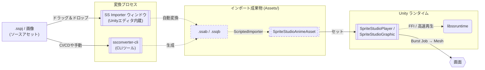

# 🎮 SpriteStudio Player for Unity — ドキュメント

[SpriteStudio](https://www.webtech.co.jp/spritestudio/) で作成したアニメーションを [Unity](https://unity.com/) 上で再生するためのハイパフォーマンスなプラグインです。再生処理は [SpriteStudio-SDK](https://github.com/cri-middleware/SpriteStudio-SDK) が提供する共通の Rust コア `libssruntime` を介して行い、Unity の Job System と組み合わせることで極限のパフォーマンスを実現します。

!!! tip "SpriteStudio のデータが手元に無くても始められます"
    [公式のサンプルデータ](https://www.webtech.co.jp/help/ja/spritestudio7/download/sample/)がそのまま使えます。キャラクターなら
    [Ringo](https://www.webtech.co.jp/help/ja/spritestudio7/download/sample/#ringo)、エフェクトを含むものなら
    [パーティクル](https://www.webtech.co.jp/help/ja/spritestudio7/download/sample/#Perticle_sample) が手頃です。

## 目次

本ドキュメントは、目的別に以下の構成となっています。

- **利用者向けガイド** — パッケージを導入してアニメーションを再生する
    - [インストール](./setup/install.md): Unity プロジェクトへのパッケージ導入
    - [基本的な使い方](./workflow/usage_basic.md): コンポーネントの配置と再生
    - [アセットのインポートとエディタ連携](./workflow/usage_asset_pipeline.md): 初回の `.sspj` インポートはこちら
    - [生成アセットの構成と AssetBundle](./workflow/generated_assets.md): ファイルごとの役割・依存関係とバンドル分割
    - [スクリプト制御とイベント](./workflow/usage_scripting.md): C# / Timeline からの制御とイベント受信
    - [モーションブレンド](./workflow/motion_blending.md): トラックへのアニメーションの重ね合わせとクロスフェード
    - [パフォーマンスチューニングと高度な設定](./workflow/tips.md): 大量描画・最適化のための設定
    - [SS6Player からのマイグレーション](./migration_from_ss6.md): 旧 SS6Player for Unity からの移行ガイド
- **カスタマイズ・自動化ガイド** — CLI や CI/CD に組み込む
    - [各種コンバート機能と CI/CD](./workflow/import.md): `ssconverter-cli` によるバッチ変換・自動化
- **[制約と適用範囲](./limitations.md)** — 未実装の機能と、出荷前に把握しておくべき制約
- **Player・SDK 開発者向けガイド** — ネイティブをソースからビルドする
    - [ビルドガイド](./setup/build.md): `libssruntime` / `libssconverter` のビルド手順

## 主な機能 (Key Features)

本プラグインは、Unity 上で SpriteStudio の表現力をフルに引き出しつつ、最高クラスのパフォーマンスを発揮するように設計されています。

*   **ほぼ完全な機能サポート:** ボーン階層、メッシュ＆デフォーム、パーティクルエフェクト、拡張ブレンド、マスクなど、SpriteStudio の多彩な表現を標準でサポートします。
*   **シームレスな統合と強力なアセットパイプライン:** `.sspj` ファイルを Unity エディタに取り込むだけでバックグラウンドで自動変換され、ScriptableObject としてすぐに扱えます。
*   **超高速・ゼロアロケーション:** Rust製コアと Unity の Job System (Burst Compiler) の組み合わせにより、毎フレームの GC アロケーションを完全に排除。多数のキャラクターを描画するモバイル環境でも極めて安定した高フレームレートを実現します。
*   **滑らかなスローモーション:** サブフレーム補間（Sub-frame interpolation）をサポートし、高リフレッシュレートのモニターやスローモーション演出でもカクつかない滑らかな再生が可能です。
*   **柔軟な UI・ワールド描画:** 通常のシーン空間での描画 (`SpriteStudioPlayer`) はもちろん、uGUI (`SpriteStudioGraphic`) の Canvas 上での描画にも対応し、Mask や RectMask2D にも自動追従します。
*   **Timeline との連携:** Timeline トラックからアニメーションを直接制御でき、カットシーンや複雑な演出を簡単に実装可能です。
*   **シグナルとイベント:** タイムライン上に設定した「ユーザーデータ」や「シグナル」を Unity のイベントとして受け取り、SEの再生やスクリプトのトリガーを正確なタイミングで行えます。
*   **モーションブレンド:** トラックにアニメーションを重ね、クロスフェードで切り替えられます。キャラクターの動きをカットせず、なめらかにつなげられます。詳しくは [モーションブレンド](./workflow/motion_blending.md) を参照してください。
*   **動的なパーツ追従:** キャラクターの特定パーツに任意の GameObject を追従（Constraint）させることができ、武器の持ち替えやエフェクトの付加を容易にします。
*   **動的なテクスチャ差し替え（着せ替え / CellMap Overrides）:** 実行時にセルマップ単位でテクスチャを差し替え、キャラクターのカラーバリエーションや衣装・装備の変更をプレイヤー個別に実装できます。

## 概要 (Overview)

本プラグインを利用してアニメーションを再生する際の流れを以下に示します。

- **エディタ (インポート時)**: `.sspj` をインポートして自動的に `.ssab` / `.ssqb` へ変換し、テクスチャ・マテリアル・アニメーション名・外部参照などを束ねた `SpriteStudioAnimeAsset` を生成します。`ssconverter-cli` による事前生成も可能です。
- **ランタイム (再生時)**: プレイヤーコンポーネントが共有コア `SpriteStudioPlaybackCore` に委譲し、`libssruntime` がフレームデータを計算、Burst ジョブが頂点を構築して Mesh に直接アップロードします。

## 対応環境

| 項目 | 内容 |
|---|---|
| Unity バージョン | **Unity 6.3 LTS (6000.3)** 以降 |
| レンダーパイプライン | Universal (URP) / Built-in (BRP) |
| 依存パッケージ | Burst / Mathematics / Collections / Timeline / uGUI（いずれも Unity 標準） |
| 対応プラットフォーム | Windows / macOS / Linux / Android / iOS / WebGL（ネイティブライブラリは [ビルドガイド](./setup/build.md) 参照） |

> **注意:** 現在のパッケージバージョンは `7.0.0-beta.1` です。API は予告なく変更される可能性があります。

## ライセンス (License)

本プロジェクトは BSD-3-Clause ライセンスのもとで公開されています。詳細は [ライセンス](./license.md) をご参照ください。

## サードパーティライセンス

本プロジェクトはサードパーティのオープンソースライブラリを使用しています。詳細は [サードパーティライセンス](./third_party_notices.md) をご参照ください。

## 関連リポジトリ

- [SpriteStudio Docs](https://cri-middleware.github.io/SpriteStudio-Docs/ja/) — SDK と公式 Player のドキュメントポータル。
- [SpriteStudio-SDK](https://github.com/cri-middleware/SpriteStudio-SDK) — `libssruntime` / `libssconverter` を提供する SDK 本体。
- [SSConverterGUI](https://github.com/cri-middleware/SSConverterGUI) — Player を介さず `.sspj` を変換するデスクトップ GUI。
