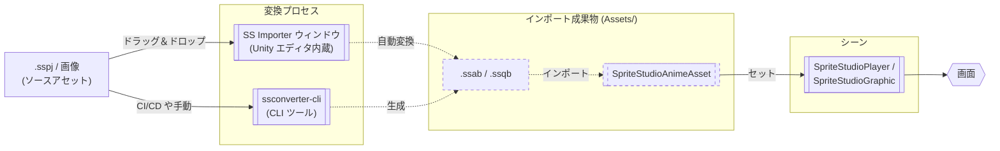

# 🎮 SpriteStudio Player for Unity — ドキュメント

[SpriteStudio](https://www.webtech.co.jp/spritestudio/) で作成したアニメーションを [Unity](https://unity.com/) 上で再生するためのプラグインです。`.sspj` を **SS Importer** ウィンドウ（**Window > SpriteStudio > Importer**）にドロップし、できたアセットを Hierarchy へドラッグして Play を押せば、コードを書かずに再生できます。

!!! tip "SpriteStudio のデータが手元に無くても始められます"
    [公式のサンプルデータ](https://www.webtech.co.jp/help/ja/spritestudio7/download/sample/)がそのまま使えます。キャラクターなら [Ringo](https://www.webtech.co.jp/help/ja/spritestudio7/download/sample/#ringo)、エフェクトを含むものなら [パーティクル](https://www.webtech.co.jp/help/ja/spritestudio7/download/sample/#Perticle_sample) が手頃です。

## 目次

本ドキュメントは、目的別に以下の構成となっています。

- **利用者向けガイド** — パッケージを導入してアニメーションを再生する
    - [インストール](./setup/install.md): Unity プロジェクトへのパッケージ導入
    - [基本的な使い方](./workflow/usage_basic.md): コンポーネントの配置と再生
    - [アセットのインポートとエディタ連携](./workflow/usage_asset_pipeline.md): 初回の `.sspj` インポートはこちら
    - [生成アセットの構成と AssetBundle](./workflow/generated_assets.md): ファイルごとの役割・依存関係とバンドル分割
    - [スクリプト制御とイベント](./workflow/usage_scripting.md): C# / Timeline からの制御とイベント受信
    - [モーションブレンド](./workflow/motion_blending.md): トラックへのアニメーションの重ね合わせとクロスフェード
    - [ボタンと UI 状態](./workflow/ui_buttons.md): 状態を見せる uGUI のボタンとトグル、絵の上だけでポインタを受ける
    - [パフォーマンスチューニングと高度な設定](./workflow/tips.md): 座標スケール・フレームスキップ・パーツ単位のシェーダ・マスク・Canvas 経路の制約
    - [SS6Player からのマイグレーション](./migration_from_ss6.md): 旧 SS6Player for Unity からの移行ガイド
- **カスタマイズ・自動化ガイド** — CLI や CI/CD に組み込む
    - [各種コンバート機能と CI/CD](./workflow/import.md): `ssconverter-cli` によるバッチ変換・自動化
- **[制約と適用範囲](./limitations.md)** — 未実装の機能と、出荷前に把握しておくべき制約
- **Player・SDK 開発者向けガイド** — ネイティブをソースからビルドし、プレイヤーの構成を知る
    - [ビルドガイド](./development/build.md): `libssruntime` / `libssconverter` のビルド手順、変更したパッケージの使い方、Unity での確かめ方
    - [プレイヤーの構成](./development/architecture.md): 層と、この作りになっている理由

## 主な機能 (Key Features)

- **キャラクターが“生きる”。** 呼吸・まばたき、なびく髪や衣装、斬撃・魔法のエフェクトまで——動きは専用エディタ（SpriteStudio）でボーン・メッシュ変形・パーティクルを使ってビジュアルに作り込みます。アーティストは自分のツールで作業し、Unity はその結果を再生するだけです。再生中のアニメーションはトラックに重ねたりクロスフェードしたりでき、歩きから走りへも飛ばずになめらかにつながります（[モーションブレンド](./workflow/motion_blending.md)）。
- **キャラクターだけでなく、エフェクトや UI、シーン全体も。** パーティクルエフェクトはキャラクターと同じタイムライン上で作れるので、別のエフェクトシステムを用意する必要はありません。キャラクター・背景・エフェクト・UI を組み合わせたカットシーンや画面全体の演出も、Unity では 1 つのアニメーションとして再生できます。
- **シーンにも UI にも。** `SpriteStudioPlayer` はワールド空間に、`SpriteStudioGraphic` は uGUI の Canvas に描画します。Canvas では `RectTransform` に収まり、**Mask** / **Rect Mask 2D** に従い、状態ごとに区間を流すボタンやトグルにもなります（[ボタンと UI 状態](./workflow/ui_buttons.md)）。どちらも C# から操作でき（パーツ単位の上書き、セルマップのテクスチャ差し替え、ユーザーデータ・シグナル・オーディオのキー通知に対応 — [スクリプト制御とイベント](./workflow/usage_scripting.md)）、`SpriteStudioPlayer` はさらにパーツへの `Transform` の追従と Timeline にも対応します。
- **SpriteStudio と Unity をシームレスに往復。** `.sspj` を **SS Importer** ウィンドウにドロップすれば、すぐ使えるアセットになります（[アセットのインポートとエディタ連携](./workflow/usage_asset_pipeline.md)）。直したくなったらインスペクタの **Open SSPJ** で SpriteStudio を開いて保存し、**Reconvert** を押すだけ。書き出しの手作業は要りません。アニメーションはシーンの外のアセットに入るので、チーム開発でシーンの Git コンフリクトが起きにくくなります。
- **パース不要の読み込みと SIMD・Burst で、軽く滑らかに。** `.ssab` は FlatBuffers のバイナリをそのまま読むので、読み込み時のパースがありません。毎フレーム、SIMD で最適化した Rust コアと Burst ジョブがゼロコピーでメッシュを組み立て、GC アロケーションも発生しません。モバイルや大量のキャラクターでも滑らかに動きます。インスペクタの **Sub-Frame Interpolation** をオンにすれば、高リフレッシュレートのディスプレイにも追従します。

## 概要 (Overview)

本プラグインを利用してアニメーションを再生する際の流れを以下に示します。

- **エディタ**: SS Importer ウィンドウが `.sspj` を `.ssab` / `.ssqb` へ変換し、テクスチャ・マテリアル・アニメーション名・外部参照などを束ねた `SpriteStudioAnimeAsset` を生成します。CI では `ssconverter-cli` で同じものを作れます。
- **ランタイム**: `SpriteStudioPlayer` はシーンに、`SpriteStudioGraphic` は uGUI の Canvas に描画します。

## ライセンス (License)

本プロジェクトは BSD-3-Clause ライセンスのもとで公開されています。詳細は [ライセンス](./license.md) をご参照ください。

## サードパーティライセンス

本プロジェクトはサードパーティのオープンソースライブラリを使用しています。詳細は [サードパーティライセンス](./third_party_notices.md) をご参照ください。

## 関連リポジトリ

- [SpriteStudio Docs](https://cri-middleware.github.io/SpriteStudio-Docs/ja/) — SDK と公式 Player のドキュメントポータル。
- [SpriteStudio-SDK](https://github.com/cri-middleware/SpriteStudio-SDK) — `libssruntime` / `libssconverter` を提供する SDK 本体。
- [SSConverterGUI](https://github.com/cri-middleware/SSConverterGUI) — Player を介さず `.sspj` を変換するデスクトップ GUI。
