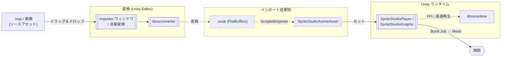

# SpriteStudioPlayer for Unity — ドキュメント

[OPTPiX SpriteStudio 7](https://www.webtech.co.jp/spritestudio/) で作成したアニメーションを [Unity](https://unity.com/) 上で再生するためのハイパフォーマンスなプラグインです。
再生処理は [SpriteStudio-SDK](https://github.com/cri-middleware/SpriteStudio-SDK) が提供する共通の Rust コア `libssruntime` を介して行い、Unity の Job System と組み合わせることで極限のパフォーマンスを実現します。

## 目次

- **セットアップ**
    - [インストール](./setup/install.md)
    - [ビルドガイド](./setup/build.md)
- **ワークフロー**
    - [基本的な使い方](./workflow/usage_basic.md)
    - [アセットのインポートとエディタ連携](./workflow/usage_asset_pipeline.md)（初回の `.sspj` インポートはこちら）
    - [スクリプト制御とイベント](./workflow/usage_scripting.md)
- **応用**
    - [インポートの自動化](./workflow/import.md)
    - [パフォーマンスチューニングと高度な設定](./workflow/tips.md)

## 主な機能 (Key Features)

本プラグインは、Unity 上で SpriteStudio 7 の表現力をフルに引き出しつつ、最高クラスのパフォーマンスを発揮するように設計されています。

*   **完全な機能サポート:** ボーン階層、メッシュ＆デフォーム、パーティクルエフェクト、拡張ブレンド、マスクなど、SpriteStudio 7 の多彩な表現を標準でサポートします。
*   **シームレスな統合と強力なアセットパイプライン:** `.sspj` ファイルを Unity エディタに取り込むだけでバックグラウンドで自動変換され、Unity 上のプレハブや ScriptableObject としてすぐに扱えます。
*   **超高速・ゼロアロケーション:** Rust製コアと Unity の Job System (Burst Compiler) の組み合わせにより、毎フレームの GC アロケーションを完全に排除。多数のキャラクターを描画するモバイル環境でも極めて安定した高フレームレートを実現します。
*   **滑らかなスローモーション:** サブフレーム補間（Sub-frame interpolation）をサポートし、高リフレッシュレートのモニターやスローモーション演出でもカクつかない滑らかな再生が可能です。
*   **柔軟な UI・ワールド描画:** 通常のシーン空間での描画 (`SpriteStudioPlayer`) はもちろん、uGUI (`SpriteStudioGraphic`) の Canvas 上での描画にも対応し、Mask や RectMask2D にも自動追従します。
*   **Timeline との連携:** Timeline トラックからアニメーションを直接制御でき、カットシーンや複雑な演出を簡単に実装可能です。
*   **シグナルとイベント:** タイムライン上に設定した「ユーザーデータ」や「シグナル」を Unity のイベントとして受け取り、SEの再生やスクリプトのトリガーを正確なタイミングで行えます。
*   **動的なパーツ追従:** キャラクターの特定パーツに任意の GameObject を追従（Constraint）させることができ、武器の持ち替えやエフェクトの付加を容易にします。

## 概要 (Overview)

本プラグインを利用してアニメーションを再生する際の流れを以下に示します。

- **エディタ (インポート時)**: `.sspj` を `libssconverter` で `.ssab` へ変換し、テクスチャ・マテリアル・アニメーション名・外部参照などを束ねた `SpriteStudioAnimeAsset` を生成します。
- **ランタイム (再生時)**: プレイヤーコンポーネントが共有コア `SpriteStudioPlaybackCore` に委譲し、`libssruntime` がフレームデータを計算、Burst ジョブが頂点を構築して Mesh に直接アップロードします。

## 対応環境

| 項目 | 内容 |
|---|---|
| Unity バージョン | **Unity 6.3 LTS (6000.3)** 以降 |
| レンダーパイプライン | Built-in (BRP) / Universal (URP) |
| 依存パッケージ | Burst / Mathematics / Collections / Timeline（いずれも Unity 標準） |
| 対応プラットフォーム | Windows / macOS / Linux / Android / iOS / WebGL（ネイティブライブラリは [ビルドガイド](./setup/build.md) 参照） |

> **注意:** 現在のパッケージバージョンは `7.0.0-alpha01` です。API は予告なく変更される可能性があります。

## 関連リポジトリ

- [SpriteStudio-SDK](https://github.com/cri-middleware/SpriteStudio-SDK) — `libssruntime` / `libssconverter` を提供する SDK 本体
- [SSPlayerForGodot](https://github.com/SpriteStudio/SSPlayerForGodot) — 同じ Rust コアを用いた Godot Engine 版プレイヤー
