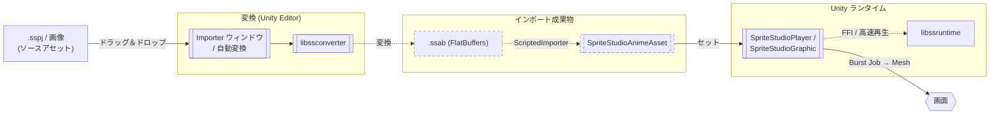

# SpriteStudioPlayer for Unity — ドキュメント

[OPTPiX SpriteStudio 7](https://www.webtech.co.jp/spritestudio/) で作成したアニメーションを Unity 上で再生するための、超高パフォーマンスなプラグインです。

このドキュメントでは、インストールから基本的な使い方、スクリプトによる制御、パフォーマンスチューニング、そしてプラグイン自体のビルドまでを解説します。

## 目次

### セットアップ
- [インストール](./setup/install.md) — パッケージの導入方法と対応環境
- [ビルドガイド](./setup/build.md) — Rust ランタイムを自分でビルドする（開発者向け）

### ワークフロー
- [基本的な使い方](./workflow/usage_basic.md) — プレイヤーの設置とアニメーション再生
- [アセットのインポートとエディタ連携](./workflow/usage_asset_pipeline.md) — `.sspj` → `.ssab` の変換と生成物
- [スクリプト制御とイベント](./workflow/usage_scripting.md) — 再生制御 API、イベント通知、パーツ追従
- [インポートの自動化](./workflow/import.md) — プロジェクト内自動変換・フォルダ一括・再変換
- [パフォーマンスチューニングと高度な設定](./workflow/tips.md) — PPU / サブフレーム / カスタムシェーダ / Canvas の制約

## 概要

本プラグインは、SpriteStudio 7 のプロジェクトファイル (`.sspj`) を Unity のアセットパイプラインへ統合します。

- **超高パフォーマンス**: 再生計算は Rust 製コア `libssruntime` が担当し、Unity の Job System (Burst Compiler) でメッシュを構築、`Mesh.SetVertexBufferData` へ直接書き込む**ゼロアロケーション**描画を行います。Tick / メッシュ構築ループで GC アロケーションを発生させません。
- **シームレスなアセットパイプライン**: `.sspj` をエディタに取り込むだけで、`libssconverter` がバックグラウンドで `.ssab` (FlatBuffers) へ変換し、`SpriteStudioAnimeAsset` (ScriptableObject) として利用できます。
- **2 つの描画経路**: ワールド空間用の `SpriteStudioPlayer` (MeshRenderer) と、Canvas UI 用の `SpriteStudioGraphic` (CanvasRenderer) を提供します。

## データフロー

本プラグインを利用してアニメーションを再生する際の流れを以下に示します。

- **エディタ (インポート時)**: `.sspj` を `libssconverter` で `.ssab` へ変換し、テクスチャ・マテリアル・アニメーション名・外部参照などを束ねた `SpriteStudioAnimeAsset` を生成します。
- **ランタイム (再生時)**: プレイヤーコンポーネントが共有コア `SpriteStudioPlaybackCore` に委譲し、`libssruntime` がフレームデータを計算、Burst ジョブが頂点を構築して Mesh に直接アップロードします。

## 主な機能

| 機能 | 説明 |
|---|---|
| ゼロアロケーション描画 | Burst Job から `Mesh.SetVertexBufferData` への直接書き込み |
| Rust コア | 公式 `SpriteStudio7-SDK` を `csbindgen` でゼロコスト FFI バインディング |
| エディタ統合 | `.sspj` のドラッグ＆ドロップ取り込み、バックグラウンド自動変換 |
| ワールド描画 | `SpriteStudioPlayer` (MeshRenderer)。Sorting Layer / Order 対応 |
| Canvas (uGUI) 描画 | `SpriteStudioGraphic` (MaskableGraphic)。uGUI Mask / RectMask2D に追従 |
| 再生制御 | 再生 / 一時停止 / 再開 / 停止 / 逆再生 / ピンポン / 区間再生 / フレーム指定 |
| イベント通知 | Finished / Looped / UserData / Signal / Audio |
| パーツ追従 | 指定パーツに任意の Transform を追従させる（constraint 方式） |
| マスク / クリッピング | ステンシルによるパーツ単位のマスク・クリッピング（ワールド経路） |
| 拡張ブレンド | Mix / Mul / Add / Sub / MulAlpha / Screen / Exclusion / Invert |
| カスタムシェーダ / AddOn | パーツ単位の AddOn（sepia / outline / blur ほか） |
| Timeline | `SpriteStudioPlayer` は `ITimeControl` 対応（Timeline トラックから駆動可能） |

## 対応環境

| 項目 | 内容 |
|---|---|
| Unity バージョン | **Unity 6.3 LTS (6000.3)** 以降 |
| レンダーパイプライン | Built-in (BRP) / Universal (URP) |
| 依存パッケージ | Burst / Mathematics / Collections / Timeline（いずれも Unity 標準） |
| 対応プラットフォーム | Windows / macOS / Linux / Android / iOS / WebGL（ネイティブライブラリは [ビルドガイド](./setup/build.md) 参照） |

> **注意:** 現在のパッケージバージョンは `7.0.0-alpha01` です。API は予告なく変更される可能性があります。

## 関連リポジトリ

- [SpriteStudio7-SDK](https://github.com/SpriteStudio/SpriteStudio7-SDK) — `libssruntime` / `libssconverter` を提供する SDK 本体
- [SSPlayerForGodot](https://github.com/SpriteStudio/SSPlayerForGodot) — 同じ Rust コアを用いた Godot Engine 版プレイヤー
