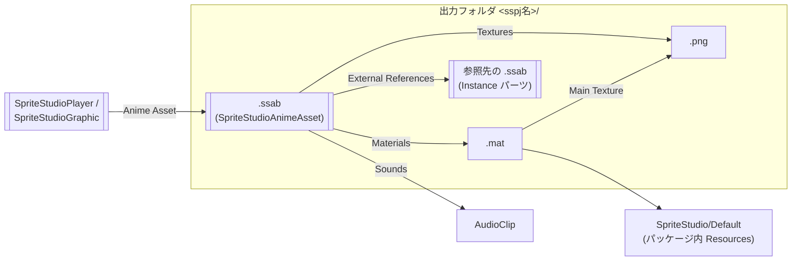

# 📦 生成アセットの構成と AssetBundle / Addressables

[← ドキュメント目次へ戻る](../index.md)

`.sspj` を変換すると、出力フォルダに複数のファイルが生成されます。このページでは、**AssetBundle / Addressables でどこまでを 1 つのバンドルにまとめるか**を決めるために必要な情報 — ファイルどうしの依存関係、再コンバートが何を上書きして何を残すのか、そして更新のたびに何を配信し直す必要があるのか — をまとめます。

インポートの手順そのものは [アセットのインポートとエディタ連携](./usage_asset_pipeline.md) を参照してください。

---

## SpriteStudio 側のファイルと出力の対応

`.sspj` を渡されて Unity 側を担当する場合、まず押さえるのは **SpriteStudio 側のどのファイルが、変換後のどれになるのか** です。`.sspj` / `.ssae` / `.ssce` / `.ssqe` それぞれの役割と変換後の対応は、Player 共通の話なのでポータルにまとめてあります。

> [!NOTE]
> [SpriteStudio Docs: アセットの変換 — プロジェクトの構成と、変換後の対応](https://cri-middleware.github.io/SpriteStudio-Docs/ja/overview/conversion/#プロジェクトの構成と変換後の対応)
>
> 要点は 2 つです。**`.ssae` 1 本が `.ssab` 1 本**になること、そして **セルの切り出し位置は `.ssce` から `.ssab` へ焼き込まれる**こと。後者が、下の「画像だけ差し替えられるか」の判断を決めます。

### SpriteStudio 側の作業と、更新される出力

| SpriteStudio 側でしたこと | 更新される出力 | 配信するとき |
|---|---|---|
| 画像を描き替えただけ（切り出しは触らない） | `.png` のみ | テクスチャのバンドルだけ差し替えれば反映されます |
| セルの追加・移動・サイズ変更、画像サイズの変更（`.ssce` が変わる） | `.png` と `.ssab` | **両方を同時に配信**してください。片方だけだと絵がずれます |
| アニメーションの修正（`.ssae`） | 該当する `.ssab` | その `.ssab` を含むバンドル |
| アニメパックの追加 | `.ssab` が 1 本増える | 新しいアセットをバンドル／グループへ登録します |
| シーケンスの修正（`.ssqe`） | `.ssqb` | 現状、ゲーム内の挙動は変わりません |

---

## 生成されるファイル

`.sspj` 1 本を変換すると、出力フォルダ（既定 `Assets/ssab_generated`）の下に `<sspj名>/` フォルダが作られ、次のファイルが並びます。

| ファイル | 生成元 | Unity 上の実体 | 何を持っているか |
|---|---|---|---|
| `<アニメパック名>.ssab` | `.ssae` 1 本につき 1 ファイル | `SpriteStudioAnimeAsset` | アニメーション（キーフレーム）、パーツ構成、**セルマップ（アトラス上の切り出し矩形・ピボット・元画像サイズ）**、エフェクト定義、ユーザーデータ／シグナル、**参照テクスチャ名（セルマップのアトラスと、テクスチャチェンジの差し替え先の両方）**、サウンド参照 |
| `<シーケンスパック名>.ssqb` | `.ssqe` 1 本につき 1 ファイル | `SpriteStudioSequenceAsset` | アニメーションの再生順（シーケンス）。再生には未対応です（[制約と適用範囲](../limitations.md)） |
| `<テクスチャ名>.png` ほか | `.sspj` が参照する画像 | `Texture2D` | 絵柄そのもの（アトラス画像） |
| `<テクスチャ名>.mat` | インポート時に自動生成 | `Material` | 描画に使う共有マテリアル（シェーダーとテクスチャ参照） |
| `*.meta` | Unity | — | GUID、テクスチャのインポート設定、AssetBundle 名 |

> [!NOTE]
> `.mat` はテクスチャ 1 枚につき 1 つだけ生成され、**同じテクスチャを参照する `.ssab` 同士で共有**されます。

> [!TIP]
> **出力先はプロジェクト内のどこでも構いません**
> `Assets/ssab_generated` は既定値にすぎません。Importer ウィンドウの **Output Folder** にはプロジェクト内の任意のフォルダを指定できますし、生成後に `<sspj名>/` フォルダごと移動・リネームしても構いません（`.sspj` とのひも付けは移動に追従し、アセットの **Reconvert** はそのフォルダに書き戻します）。Addressables のグループをフォルダで切っている場合は、その構成に合わせて置いてください。
>
> ただし **`.ssab` と画像・`.mat` の相対位置は保ってください**。テクスチャは `.ssab` と同じフォルダの中だけを探索し、プロジェクト全体は検索しません。フォルダの中身を分けて配置すると解決に失敗します。

---

## 依存関係

- **参照はすべて GUID のハードリファレンス**です。実行時にファイルパスを解決しないため、Resources / AssetBundle / Addressables のどこに置いても参照は解決されます。裏を返すと、`.ssab` を含むバンドルは依存先（`.mat` → `.png`、`AudioClip`、Instance の参照先 `.ssab`）も引き込みます。
- **パスで探すのはインポート時だけ**です。`.ssab` と同じフォルダにあるテクスチャを探し、そのテクスチャに隣接する `.mat` を使います。フォルダ内のファイルはまとめて移動してください。
- 上図の **Textures** は 2 種類を含みます。セルマップのアトラスと、**テクスチャチェンジ（TCHG）で差し替える先**のテクスチャです。どちらも Importer が収集して GUID で参照するため、片方だけバンドルから漏れることはありません。
- **シェーダー**はパッケージの `Runtime/Resources` にあるため、プレイヤー本体のビルドに必ず含まれます。生成するマテリアルのシェーダーは、`.ssab` を選択したときのインポート設定（**Generate Materials** / **Override Shader**）で変更できます。

---

## 再コンバートで上書きされるもの・されないもの

| 対象 | 再コンバートしたとき |
|---|---|
| `.ssab` / `.ssqb` / 画像 | **上書き**されます。ファイルを削除せず書き換えるため、`.meta`（GUID・AssetBundle 名）はそのまま残り、GUID で管理される Addressables のグループ割り当ても維持されます |
| `.mat` | 既に存在すれば**再生成しません**。差し替えたシェーダーや調整したプロパティは残ります |
| テクスチャのインポート設定 | Unity が初めて取り込むときだけ、2D アニメーション向けの既定（無圧縮・Clamp・Mipmap 無効など）を適用します。以降、手で変更した設定を上書きすることはありません |
| **1 回**のインポートに同名の `.sspj` が複数含まれる場合 | 出力フォルダが同じになるため、最初の 1 つだけを変換します。残りはコンソールに一覧で出ます — どちらかをリネームするか、別々の出力フォルダにインポートしてください |
| `.sspj` から削除された画像・アニメパック | 出力フォルダに**古いファイルが残ります**。不要であれば手動で削除してください |

---

## AssetBundle / Addressables の分け方

生成されるのは通常の Unity アセットで、参照は GUID です。そのため **標準の AssetBundle / Addressables のフローがそのまま使えます**。Player 側に固有の手順はありません。

設計上の判断はひとつだけ、**「どの粒度で差し替えたいか」** です。

| 分け方 | 向いているケース | 注意点 |
|---|---|---|
| **A. `<sspj名>/` フォルダを丸ごと 1 バンドル** | まず動かす場合。キャラクター単位でまとめて更新する | 絵の修正だけでもフォルダ全体を配信することになります |
| **B. テクスチャだけを別バンドルにする** | 差分配信で見た目だけを更新したい | アトラス配置と画像サイズを変えないこと（変えるなら `.ssab` も同時更新） |
| **C. 共有アセットを専用バンドルへ** | 複数の `.ssab` が同じアトラスや同じ Instance 参照先を共有している | 共有側を更新すると、参照している全員に影響します |

> [!IMPORTANT]
> バンドル（グループ）へ明示的に登録しなかった依存アセットは、**それを参照する各バンドルに複製されて入ります**。同じテクスチャや Instance の参照先を複数のキャラクターで共有している場合は、共有される側も明示的に登録してください。Addressables では Groups ウィンドウの **Tools > Check Duplicate Bundle Dependencies** で検出できます。

### 見た目だけを差し替える手順（パターン B）

1. `.png` を独立したグループ／バンドルに割り当てます（`.ssab` や `.mat` は別のバンドルで構いません）。
2. バンドルとアプリをビルドして配信します。
3. 絵を描き替え、SpriteStudio 側でリロードして `.sspj` を保存します。
4. Unity で対象アセットの **Reconvert** を実行します。`.png` は上書きされ、`.meta` が維持されるためバンドル割り当ては変わりません。（`.sspj` を Importer ウィンドウへドロップしても変換はできますが、書き先は `<Output Folder>/<sspj名>/` です。フォルダを移動・リネームした後は別の場所になります。）
5. バンドルを再ビルドし、テクスチャのバンドルだけを配信します。

> [!WARNING]
> この差し替えが成立するのは、**アトラスの切り出し位置・サイズ・画像全体のサイズが変わらないとき**だけです。SpriteStudio 側でセルを追加・移動したり画像サイズを変えたりした場合、切り出し矩形を持つ `.ssab` が古いままだと絵がずれます。その場合は `.ssab` を含むバンドルも併せて更新してください。
