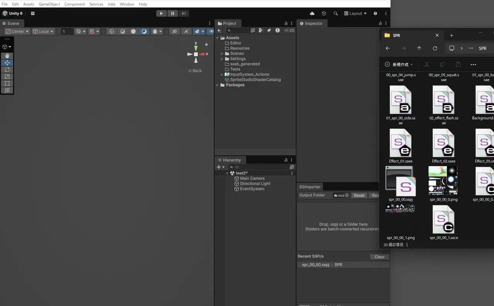
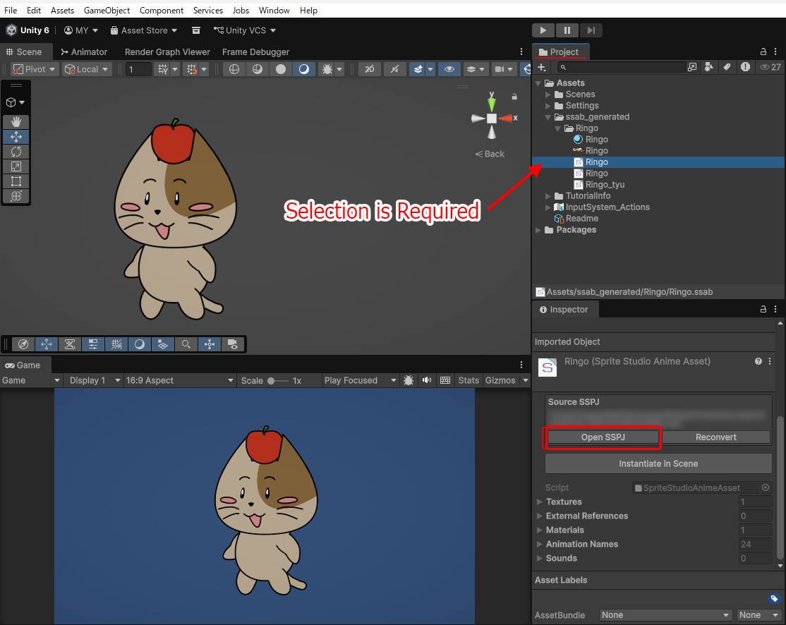
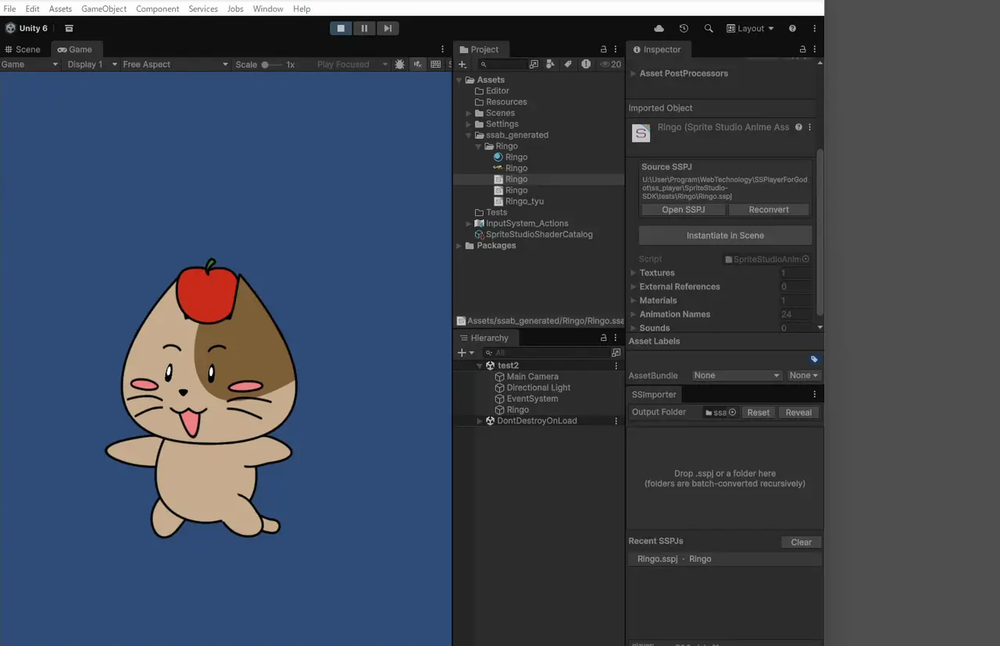

# 🗂️ アセットのインポートとエディタ連携

[← ドキュメント目次へ戻る](../index.md)

このページでは **`.sspj` を Unity プロジェクトへ取り込む（コンバートする）初回手順** と、その後 SpriteStudio と Unity を行き来しながら高速にイテレーションを回すためのワークフローを解説します。

SpriteStudioPlayer for Unity は単にアニメーションを再生するだけでなく、**SpriteStudio と Unity をシームレスに行き来できる強力なアセットパイプライン**を提供します。これにより、アニメーションの修正からゲームへの反映までのイテレーションを高速に回すことができます。

---

## 1. 初回のインポート (.sspj から .ssab へのコンバート)

SpriteStudio の元データであるプロジェクトファイル（`.sspj`）は、そのままでは Unity 上で再生できません。
Unity 上で再生・制御可能な専用の最適化バイナリ（**`.ssab`**）へ変換（コンバート）して取り込む必要があります。

まだ Unity プロジェクト内に `.ssab` が存在しない場合は、以下の手順で初回のコンバートを行います。

1. Unity メニューから **Window > SpriteStudio > Importer** を開きます。
2. 出力先（**Output Folder**、デフォルトは `Assets/ssab_generated`）を確認します。
3. エクスプローラーや Finder から、目的の **`.sspj` ファイルを SpriteStudio Importer ウィンドウのドロップ領域へドラッグ＆ドロップ** します。

これだけでコンバート処理が走り、指定した出力先に `SpriteStudioAnimeAsset`（`.ssab` を内包した ScriptableObject）が生成されます。
生成されたアセットを Hierarchy ウィンドウや Scene ビューへドラッグ＆ドロップして、`SpriteStudioPlayer` / `SpriteStudioGraphic` を配置しましょう（詳細は [基本的な使い方](./usage_basic.md) を参照）。

> [!TIP]
> 
> <video autoplay loop muted playsinline width="100%">
>   <source src="../assets/1-sspj_import.webm" type="video/webm">
> </video>
> 

> [!TIP]
> フォルダごとドロップすると、その中の `.sspj` を再帰的に `.ssab` へ一括変換します。詳しくは [各種コンバート機能と CI/CD](./import.md) を参照してください。

---

## 2. Unity から SpriteStudio を直接開く

Unity で作業中に「もう少しアニメーションを微調整したい」と思った場合、わざわざ SpriteStudio を別で立ち上げてプロジェクトを探す必要はありません。

1. プロジェクトウィンドウで、編集したい **`SpriteStudioAnimeAsset` を選択**します。
2. インスペクタ上部の **「Source SSPJ」** に、元となった `.sspj` のパスが表示されます。
3. その下にある **「Open SSPJ」ボタン** をクリックします。

この操作により、SpriteStudio が起動して元となる `.sspj` ファイルが開き、すぐに編集作業に入ることができます。

> [!NOTE]
> 

> [!NOTE]
> 同等の操作は **Window > SpriteStudio > Importer** の **Recent SSPJs** リストからも行えます（行を右クリック →「Open SSPJ」）。

---

## 3. 強力なアセットパイプライン (シームレスなエディタ間連携)

SpriteStudio 側でアニメーションを修正して保存したら、Unity エディタに戻ります。
以下の操作だけで、変更内容がゲーム（およびエディタ上のプレビュー）に一瞬で反映されます。

1. 先ほどと同様に、プロジェクトウィンドウで対象の **`SpriteStudioAnimeAsset`** を選択します。
2. インスペクタの「Open SSPJ」ボタンの横にある **「Reconvert」ボタン** をクリックします。

> [!IMPORTANT]
> **「開く」→「保存」→「再コンバート」の最短ワークフロー**
> アセットを選択したままインスペクタから SpriteStudio を呼び出し、編集後すぐに Unity 上で `.ssab` へ最新の変更を反映（再コンバート）させることができます。**SpriteStudio と Unity をシームレスに行き来できるこの強力なアセットパイプライン**により、アニメーション調整におけるトライアンドエラーのコストが劇的に下がります。

> [!TIP]
> SpriteStudio Importer ウィンドウの **Recent SSPJs** からも再変換できます（行をクリック、または右クリック →「Reconvert」）。同一内容（更新日時が同一）の `.sspj` は無駄な再変換をスキップします。

> [!TIP]
> 
> <video autoplay loop muted playsinline width="100%">
>   <source src="../assets/2-fast_iteration_inspector.webm" type="video/webm">
> </video>
> 

---

## 生成される `SpriteStudioAnimeAsset` (.ssab)

インポートの最終成果物（変換された `.ssab` データの実体）です。再生に必要な情報をすべて保持し、ビルド時のストリッピング（不要アセット除去）を防ぐためのハードリファレンスも兼ねます。

| フィールド | 説明 |
|---|---|
| **Ssab Data** | 変換済みの `.ssab` バイナリ本体 |
| **Animation Names** | このアセットに含まれるアニメーション名の一覧 |
| **Textures** | 参照テクスチャ（ストリッピング防止のハードリファレンス） |
| **Materials** | 描画に使うベースマテリアル群 |
| **External References** | Instance パーツが参照する外部アニメーション（別パックの `SpriteStudioAnimeAsset`） |
| **Sounds** | Audio イベントが参照する `AudioClip` |

> [!NOTE]
> アニメーションが他のアニメーション（Instance パーツ）を参照する場合、その参照先は **External References** に解決されます。実行時はファイルを読み込まずハードリファレンスを辿るだけなので、Resources / AssetBundle / Addressables のいずれでも安全に動作します。

`.ssab` をインポートする際、参照テクスチャに対応する**共有マテリアル (`.mat`)** が隣接位置に自動生成され、アセットへ束ねられます。また、`.sspj` / `.ssab` と同フォルダのテクスチャには、2D アニメーション向けのインポート設定（無圧縮・Clamp・Mipmap 無効など）が自動適用されます。

---

## 制限事項とチーム開発時の注意点

この強力なエディタ間連携機能（`Open SSPJ` および `Reconvert`）は非常に便利ですが、その仕組み上、いくつかの制限があります。特にチーム開発を行う場合は注意してください。

> [!WARNING]
> **SpriteStudio のインストールが必要です**
> `Open SSPJ` ボタンを押すと、OS の関連付けにより SpriteStudio が起動します。そのため、操作する PC 自体に [SpriteStudio](https://www.webtech.co.jp/spritestudio/) がインストールされている必要があります。

> [!TIP]
> **チーム開発時のファイルパス共有とスマート再リンク**
>
> SpriteStudio Importer ウィンドウ経由でインポートした際の連携情報（`.ssab` ↔ `.sspj` のひも付け）は、Unity プロジェクト直下の `ProjectSettings/SpriteStudioSourceMap.json` に **相対パス** で保存されます。
>
> このファイルを Git 等のバージョン管理システムで共有することで、チームの別メンバーが PC に `git clone` した場合でもパスの連携が維持され、そのまま `Open SSPJ` や `Reconvert` を利用できます。
>
> 万が一、フォルダ構造の変更などにより `.sspj` へのリンクが切れてしまった場合でも簡単に修復できます。`SpriteStudioAnimeAsset` のインスペクタに表示される **「Relink SSPJ...」** ボタンを押すと、新しい `.sspj` の場所を尋ねるダイアログが表示されます。ここで 1 つのファイルを再リンクするだけで、同じ出力フォルダ内にある他の関連 `.ssab` も**まとめてスマート再リンク＋再変換**されるため、修復の手間がかかりません。
