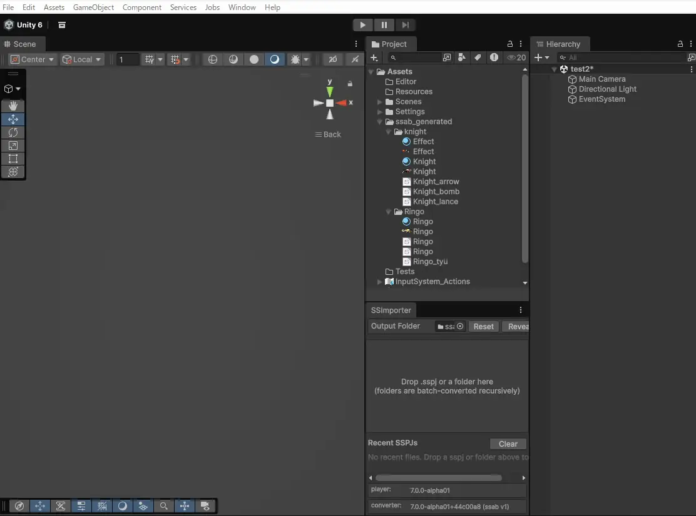
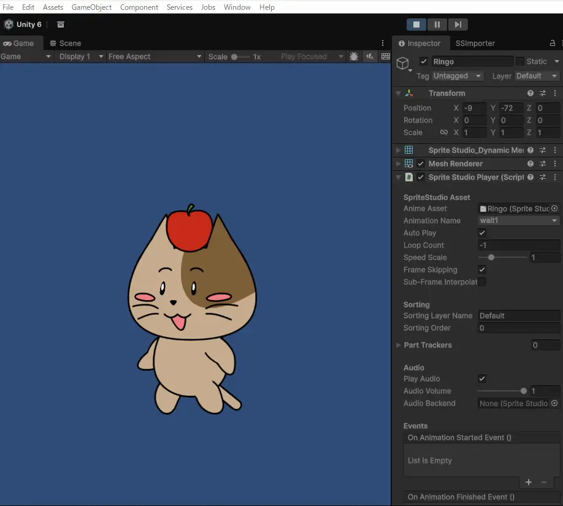
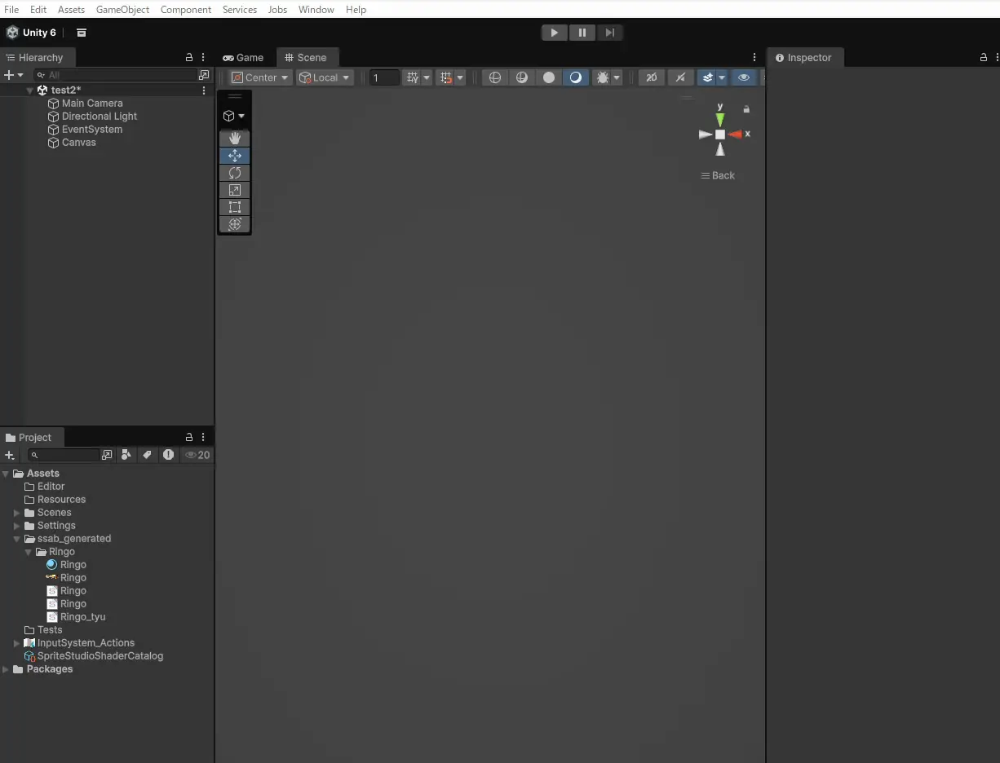

# ▶️ 基本的な使い方

[← ドキュメント目次へ戻る](../index.md)

ここでは、`.sspj` をインポートしてからアニメーションを再生するまでの最短手順を説明します。インポートの詳細は [アセットのインポートとエディタ連携](./usage_asset_pipeline.md)、スクリプトによる制御は [スクリプト制御とイベント](./usage_scripting.md) を参照してください。

## 1. アニメーションをインポートする

1. Unity メニューから **Window > SpriteStudio > Importer** を開きます。
2. **Output Folder**（出力先）を設定します（既定は `Assets/ssab_generated`）。
3. SpriteStudio で作成した `.sspj` ファイルを、ウィンドウのドロップ領域へドラッグ＆ドロップします。

変換が完了すると、出力先に `SpriteStudioAnimeAsset`（`.ssab` を内包した ScriptableObject）が生成されます。

> [!TIP]
> 手元に `.sspj` がまだ無い状態で試したい場合は、[SpriteStudio 公式のサンプルデータ](https://www.webtech.co.jp/help/ja/spritestudio7/download/sample/)がそのまま使えます。キャラクターなら [Ringo](https://www.webtech.co.jp/help/ja/spritestudio7/download/sample/#ringo)、エフェクトを含むものなら [パーティクル](https://www.webtech.co.jp/help/ja/spritestudio7/download/sample/#Perticle_sample) が手頃です。ダウンロードした `.sspj` を、上と同じ手順でドロップしてください。

## 2. プレイヤーを設置する

用途に応じて 2 種類のコンポーネントを使い分けます。

| 用途 | コンポーネント | 描画方式 |
|---|---|---|
| 3D / 2D のワールド空間 | `SpriteStudioPlayer` | MeshRenderer |
| Canvas (uGUI) の UI | `SpriteStudioGraphic` | CanvasRenderer |

### 方法 A: アセットをドラッグ＆ドロップして設置する（推奨）

最も手軽な方法です。インポートで生成された `SpriteStudioAnimeAsset`（SpriteStudio のアイコンが付いたアセット）を、プロジェクトウィンドウから **Hierarchy ウィンドウ**（または **Scene ビュー**）へドラッグ＆ドロップします。

ドロップすると設置するコンポーネントを選ぶメニューが表示されるので、用途に応じて選択してください。

- **SpriteStudioPlayer** … ワールド空間用。選んだアセットを割り当てた GameObject が作成されます。
- **SpriteStudioGraphic (Canvas UI)** … Canvas UI 用。

選択すると GameObject が作成され、**Anime Asset には今ドロップしたアセットが自動的に割り当てられます**。あとは **Animation Name** を設定すれば再生できます。

> [!TIP]
> - **SpriteStudioGraphic (Canvas UI)** を選んだ際にシーンへ `Canvas` が無い場合は、`Canvas`（および `EventSystem`）が自動的に作成され、その下に設置されます。
> - Hierarchy 上で既存の GameObject の上にドロップすると、その子として設置されます。
> - 複数のアセットを同時にドロップした場合は、まとめて設置されます。
> - `SpriteStudioAnimeAsset` のインスペクタにある **「Instantiate in Scene」** ボタンからもワールド用プレイヤーを設置できます。

> [!TIP]
> 
> <video autoplay loop muted playsinline width="100%">
>   <source src="../assets/3-setup_drag_and_drop.webm" type="video/webm">
> </video>
> 

### 方法 B: コンポーネントを手動で追加する

空の GameObject を用意し、自分でコンポーネントを追加する方法です。

#### ワールド空間に置く場合（`SpriteStudioPlayer`）

1. 空の GameObject を作成します。
2. **Add Component** から **SpriteStudio Player** を追加します（`MeshFilter` / `MeshRenderer` は自動で付与されます）。
3. インスペクタの **SpriteStudio Asset** 見出しの下にある **Anime Asset** に、インポートした `SpriteStudioAnimeAsset` を割り当てます。
4. **Animation Name** に再生したいアニメーション名を入力します。

#### Canvas (uGUI) に置く場合（`SpriteStudioGraphic`）

1. **Canvas** 下に空の GameObject を作成します。
2. **Add Component** から **SpriteStudio Graphic** を追加します（`RectTransform` / `CanvasRenderer` は自動で付与されます）。
3. **Anime Asset** と **Animation Name** を上記と同様に設定します。

## 3. 再生する

**Auto Play** が有効（既定）であれば、再生（Play）モードに入ると **Animation Name** のアニメーションが自動的に再生されます。オブジェクトを再び有効にしたとき（プールから `SetActive(true)` で取り出したときなど）も、Animator と同じく最初から再生し直します。

スクリプトから明示的に再生する場合は次のようにします。

```csharp
using SpriteStudio.Runtime;
using UnityEngine;

public class Sample : MonoBehaviour
{
    [SerializeField] private SpriteStudioPlayer _player;

    void Start()
    {
        _player.SetAnimation("walk"); // アニメーションを指定（データをロード）
        _player.Play();               // 再生開始
    }
}
```

## インスペクタの主な設定項目

項目名はインスペクタの表示どおりに記載しています。並び順もインスペクタに合わせてあります。

### 両コンポーネント共通

| 項目 | 既定値 | 説明 |
|---|---|---|
| **Anime Asset** | （なし） | 再生対象の `SpriteStudioAnimeAsset`。**SpriteStudio Asset** という見出しの下に置かれています |
| **Animation Name** | `""` | 再生するアニメーション名。アセットを割り当てるとドロップダウンで選べます |
| **Auto Play** | `true` | シーンの実行起動時と、コンポーネントを再び有効にしたときに自動再生するか |
| **Loop Count** | `-1` | ループ回数（`-1` = 無限 / `1` = 1 回 / `n` = n 回 / `0` = 無限、`-1` の別名） |
| **Speed Scale** | `1.0` | 再生速度の倍率（`0`〜`4` のスライダー。`0` は停止） |
| **Frame Skipping** | `true` | 実時間追従。ON = 経過時間ぶん進める / OFF = 毎 update で 1 フレームずつ |
| **Sub-Frame Interpolation** | `false` | フレーム間補間（サブフレーム描画）を行うか |

音声の項目も共通です。

| 項目 | 既定値 | 説明 |
|---|---|---|
| **Play Audio** | `true` | 音源イベント（ADIO）の音を鳴らすか。これが OFF のあいだ、下の 2 項目は灰色（無効）になります |
| **Audio Volume** | `1.0` | 組み込み再生の音量。**Audio Backend** を使う場合は無視されます |
| **Audio Backend** | （なし） | 音声ミドルウェア等へ再生を差し替えるためのフック（[スクリプト制御とイベント](./usage_scripting.md) 参照） |

インスペクタの末尾には、再生イベントの UnityEvent（**On Animation Started Event** / **On Animation Finished Event** / **On Animation Looped Event** / **On User Data Event** / **On Signal Event** / **On Audio Event**）が並びます。詳細は [スクリプト制御とイベント](./usage_scripting.md) を参照してください。

### `SpriteStudioPlayer`（ワールド）のみ

| 項目 | 既定値 | 説明 |
|---|---|---|
| **Sorting Layer Name / Sorting Order** | `Default` / `0` | 描画順（MeshRenderer のソート設定） |
| **Flip X / Flip Y** | `false` / `false` | 描画だけを左右／上下に反転します（`SpriteRenderer.flipX` と同じ考え方で、Transform を反転しないため子オブジェクトやコライダは動きません） |
| **Offset** | `(0, 0)` | Transform を動かさずに描画位置だけをずらします（単位はワールド単位） |
| **Part Trackers** | （空） | 指定パーツに Transform を追従させる設定（[スクリプト制御とイベント](./usage_scripting.md) 参照） |

> **Pixels Per Unit** とパーツ単位の**カスタムシェーダ**は、このインスペクタ外で設定します。PPU はスクリプトの `PixelsPerUnit` プロパティで設定し、カスタムシェーダは AddOn カタログに登録します。詳細は [高度な設定](./tips.md) を参照してください。

### `SpriteStudioGraphic`（Canvas UI）のみ

uGUI の `Graphic` 由来の **Color** / **Material** / **Raycast Target** / **Raycast Padding** が表示されます。**Color** は `Image` と同じくアニメーション全体をパーツカラーの上から色付けし、Button の **Color Tint** トランジションや `CrossFadeColor` / `CrossFadeAlpha` も同じように効きます。クリック判定の範囲は `RectTransform` の矩形で決まり、アニメーションの見た目の大きさとは連動しません。判定範囲を広げたい場合は `RectTransform` のサイズか **Raycast Padding** で調整してください。

> [!TIP]
> 
> <video autoplay loop muted playsinline width="100%">
>   <source src="../assets/4-inspector_preview.webm" type="video/webm">
> </video>
> 

## 編集モードでのプレビュー

両コンポーネントは編集モードでも動作します。シーンに設置すれば、Play モードに入らなくても**開始フレームの静止プレビュー**が Scene / Game ビューにそのまま表示されます。有効・無効を切り替える設定項目はなく、常に有効です。

ただし編集モードで表示されるのは静止画で、再生は進みません。アニメーションの動きを確認するには **Play モード**に入ってください。

## マスクパーツへの対応

本プラグインは SpriteStudio の「マスク機能（Mask）」にも対応しています。

- **ワールド（`SpriteStudioPlayer`）**: 特別な設定は不要です。`.ssab` にマスクパーツが含まれていれば、ステンシルバッファを用いて自動的にクリッピング処理が行われます。そのままシーンに配置してお使いいただけます。
- **Canvas（`SpriteStudioGraphic`）**: SpriteStudio 内部のマスクは抑止され、代わりに uGUI の **Mask** / **RectMask2D** に追従します（親にこれらを置くとクリップされます）。

詳細は [パフォーマンスチューニングと高度な設定](./tips.md#マスク--クリッピング) を参照してください。

> [!TIP]
> 
> <video autoplay loop muted playsinline width="100%">
>   <source src="../assets/6-mask.webm" type="video/webm">
> </video>
> 
